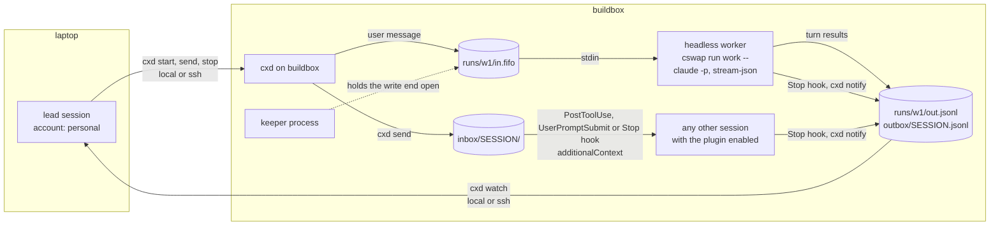

# cswap-cross-device

[](LICENSE)
[](https://github.com/guuslangelaar0/cswap-cross-device/actions/workflows/ci.yml)
[](https://github.com/guuslangelaar0/cswap-cross-device/releases)
[](#requirements)
[](#requirements)
[](#install)

**A Claude Code plugin and a small CLI (`cxd`) that let one Claude Code session run, steer,
follow, stop and resume other Claude Code sessions, on another
[cswap](https://github.com/realiti4/claude-swap) account, on another machine, or both.**

## What it is

You have a *lead* session that plans and reviews, and *worker* sessions that do the work.
`cxd start` launches a headless worker under any cswap account, here or on a machine you
reach over ssh. `cxd send` gives it a new instruction while it runs, `cxd watch` streams
its progress (turns, cost, PR links, reports), and `cxd stop` / `cxd resume` end it and
pick the same conversation up again later. Interactive sessions that you started yourself
can be messaged too: the plugin's hooks register every session and deliver queued messages
into it. Workers report back with `cxd notify`, and every turn's final answer is recorded
for the lead automatically.

## Why

Claude Code's own cross-session messaging works only between sessions of the same account.
[cswap (claude-swap)](https://github.com/realiti4/claude-swap) lets you run several Claude
accounts side by side (`cswap run work`, `cswap run personal`), so a session on one account
has no way to message, steer or hear back from a session on another, let alone one running
headless on a build machine. This plugin adds that channel. It needs no server and no
network listener: it uses files on the machine that owns the session, and `ssh` to reach
other machines.

## How it works



- **Headless runs.** `cxd start` creates `~/.cxd/runs/<name>/` with a FIFO and starts
  `claude -p --input-format stream-json --output-format stream-json` (through
  `cswap run <account> --` when you name an account) with the FIFO as stdin. A small
  *keeper* process holds the write end open, so stdin never reaches EOF between messages
  and the session stays up. `cxd send` writes one stream-json user message into the FIFO;
  Claude Code takes it as the next turn. The output goes to `out.jsonl`, which
  `cxd watch` turns into one line per event.
- **Other sessions.** The plugin's `SessionStart` hook registers every session in
  `~/.cxd/sessions/`. `cxd send <host> <session-id>` drops a message in that session's
  inbox, and its next `PostToolUse`, `UserPromptSubmit` or `Stop` hook delivers it as
  `additionalContext` (a message that reads *"Message from the lead session …"*). Delivery is
  at-least-once: a hook claims the message, and only once it has written it out is the
  message marked delivered. If a hook is killed, times out or cannot write in between, the
  session's next hook delivers the message again. Each message carries its id, so the rare
  repeat is recognisable. A long message (up to 1,000,000 characters) is queued as numbered
  parts that each fit in one delivery; they arrive whole, in order as the session's hooks run
  one after another.
  A message delivered at `Stop` keeps the session going: Claude reads it and acts on it
  before the turn ends (Claude Code documents Stop-hook `additionalContext` as feedback the
  conversation continues on; observed with Claude Code 2.1.302).
- **Reports.** The `Stop` hook appends the last assistant message of every turn to the
  session's outbox, and a worker can add its own lines with `cxd notify "…"`. The lead
  sees them in `cxd watch`.
- **Transport.** Each operation runs on the host that owns the run. `cxd` calls it
  directly for the local machine and through `ssh <alias> python3 ~/.cxd/bin/cxd _rpc` (one
  JSON request, one JSON reply or stream) for a remote one. A broker transport is on the
  [roadmap](#limitations-and-roadmap).

## Requirements

| | |
| --- | --- |
| Claude Code | tested with 2.1.302 (uses `-p` stream-json input and output, plugin hooks, `additionalContext`) |
| Python | 3.9 or newer, standard library only (CI runs 3.9, 3.12 and 3.14) |
| OS | macOS or Linux (FIFOs, POSIX signals). Windows is not supported. |
| cswap | [claude-swap](https://github.com/realiti4/claude-swap) (`uv tool install claude-swap`), needed only to run workers under other accounts. Single-account use works without it. |
| ssh | only for remote hosts: a key-based alias in `~/.ssh/config` that works with `BatchMode=yes` |

## Install

Add this repository as a plugin marketplace and install the plugin:

```bash
claude plugin marketplace add guuslangelaar0/cswap-cross-device
claude plugin install cswap-cross-device@cswap-cross-device
```

The marketplace installs the latest [release](https://github.com/guuslangelaar0/cswap-cross-device/releases):
its entry is pinned to the release tag and to that tag's commit, so `main` can move ahead
without changing what you install. CI checks that the pin, the tag and the plugin version
agree.

With cswap, each account has its own Claude Code profile, so install the plugin once per
account that should run the hooks or use `cxd`:

```bash
cswap run work -- plugin marketplace add guuslangelaar0/cswap-cross-device
cswap run work -- plugin install cswap-cross-device@cswap-cross-device
cswap run personal -- plugin marketplace add guuslangelaar0/cswap-cross-device
cswap run personal -- plugin install cswap-cross-device@cswap-cross-device
```

Sessions that are already running pick the plugin up when they restart. While the plugin is
enabled, Claude Code puts its `bin/` directory on the Bash tool's `PATH`, so `cxd` works
inside sessions without further setup.

Then, **on every machine**, name it and its peers. Run this inside a Claude Code session
that has the plugin (or from a clone of this repository, as `./bin/cxd init …`):

```bash
cxd init --self laptop --peer buildbox --account work --account personal   # on the laptop
cxd init --self buildbox --account work                                    # on the build machine
cxd doctor
```

`cxd init` writes `~/.cxd/config.json` and links `~/.cxd/bin/cxd` to the copy of `cxd` it
was run from; peers run that path over ssh. Re-run `cxd init` (no flags needed) after the
plugin updates. To use `cxd` from a plain terminal, add `~/.cxd/bin` to your `PATH`.

**Upgrade** to a new release, per account (with cswap, replace `claude` with
`cswap run <account> --`):

```bash
claude plugin marketplace update cswap-cross-device
claude plugin update cswap-cross-device@cswap-cross-device
```

Then, on every machine, run `cxd init` and `cxd doctor` from a new Claude Code session. Its
`cxd` is the updated plugin, so `~/.cxd/bin/cxd` (the path peers use) moves to the new
version. Run from an older session or a terminal, `cxd init` would link the copy it runs
from.

## Quick start

```bash
# 1. Start a worker on the build machine under the "work" account.
cat > prompt.md <<'EOF'
Fix the failing test in tests/test_parser.py, run the suite, and report the result.
EOF
# Headless workers cannot answer permission prompts: allow what the task needs.
cxd start buildbox w1 prompt.md --account work --cwd ~/src/project \
  -- --permission-mode acceptEdits --allowedTools "Bash(pytest *)"

# 2. Follow it (in Claude Code, run this with the Monitor tool).
cxd watch buildbox w1

# 3. Steer it while it works.
cxd send buildbox w1 "Also add a regression test for the empty-input case."

# 4. Stop it, and later continue the same conversation.
cxd stop buildbox w1
cxd resume buildbox w1 next.md
```

To message a session you started by hand, find its id with `cxd list` and use it (or a
unique prefix of 8+ characters) as the target: `cxd send laptop 3f2a9c1e "…"`.

## Permissions

A headless worker has nobody to answer a permission prompt. `cxd` does not bypass them
unless you ask: a tool call that needs approval is refused (with Claude Code 2.1.302 the
call is denied and the turn carries on without it), so a worker can stall on work it is not
allowed to do. `cxd start` and `cxd resume` warn once on stderr when a run has no bypass.

Where you can, grant what the task needs with Claude Code's own flags after `--`:
`-- --permission-mode acceptEdits` accepts file edits, and
`-- --allowedTools "Bash(git *)"` allows matching commands. Both pass straight through.

Skipping every check (`--dangerously-skip-permissions`) is opt-in, per run with
`cxd start … --skip-permissions` or `cxd resume … --skip-permissions` (the run keeps that
choice), or per host with `"skip_permissions": true` in the `~/.cxd/config.json` of the host
that runs the worker (any other value counts as false). The host setting is read each time a
run starts or resumes, so turning it off stops the bypass for runs that did not opt in
themselves. It is opt-in because a bypassed worker can run any command and change any file
your user can, without asking. Use it only in directories and on machines you would let it
change freely. `cxd resume … --no-skip-permissions` withdraws a run's own opt-in (not the
host's: if the host still opts in, the command says so and exits 5). Runs
started by cxd 0.1.0 resume without the bypass unless you opt in again (0.1.0 stored the
choice mixed with the host setting). If a host does not apply a `--skip-permissions` you
asked for (it runs an older `cxd`), the command says so and exits 5: the run is running,
without the bypass.

## Commands

`<host>` is a name from `~/.cxd/config.json`, this machine's own name, or `local`.

| Command | Flags | What it does |
| --- | --- | --- |
| `cxd start <host> <name> <prompt-file\|->` | `--account A`, `--cwd DIR`, `--skip-permissions`, `--init-timeout S` (90), `--json`, `-- <claude args>` | Start a headless run named `<name>` with the prompt as its first message. Without `--account` it uses `default_account` from the host's config, or plain `claude` if none is set. Arguments after `--` go to `claude`. Permission prompts are bypassed only with `--skip-permissions` or the host's `skip_permissions` (see [Permissions](#permissions)). |
| `cxd send <host> <run\|session> <text\|@file\|->` | `--json` | Send a message: into the FIFO for a run, into the inbox for a session. Refuses a target that is not running. |
| `cxd watch <host> <run\|session>` | `--json`, `--heartbeat S` (60), `--from-start` | Stream events, one line each, until the target exits. |
| `cxd list [host]` | `--all`, `--json` | Runs and live sessions on one host, or on every configured host. `--all` includes ended sessions. |
| `cxd stop <host> <name>` | `--now`, `--grace S` (120), `--int-wait S` (15), `--term-wait S` (10), `--json` | Stop a run (see [Stop semantics](#stop-semantics)) and report its exit code. |
| `cxd resume <host> <name> <prompt-file\|->` | `--skip-permissions` or `--no-skip-permissions`, `--init-timeout S` (90), `--json` | Continue an exited run's conversation (`--resume <session id>`) with a new prompt. Refuses while the run is alive. Keeps the run's own permission choice; `--skip-permissions` opts in, `--no-skip-permissions` withdraws it. |
| `cxd notify <text\|@file\|->` | `--session SID` | Inside a worker: add a report to its outbox (uses `CLAUDE_CODE_SESSION_ID`). |
| `cxd doctor [host...]` | `--json` | Check every host: ssh round-trip, `cxd` home mode, cswap, claude, a hook self-test, and whether the plugin is enabled per account. |
| `cxd init` | `--self NAME`, `--peer ALIAS` (repeatable), `--account A` (repeatable), `--default-account A` | Write `~/.cxd/config.json` and link `~/.cxd/bin/cxd`. |
| `cxd --version` | | Print the version. |

Exit codes: `0` ok, `2` usage, `3` refused (dead run, alive on resume, unknown target, start
failure), `4` transport failure (the host could not be reached, so nothing was decided), `5`
started or resumed, but the permission choice you asked for (`--skip-permissions` or
`--no-skip-permissions`) was not applied: the run is running.

**`watch` lines:** `status`, `session … started`, `turn N ended cost=$…: <result>`,
`PR <url>`, `delivered message <id> via <Hook> hook`, `report (stop|notify): …`,
`heartbeat`, `EXITED …`. After `EXITED`, watch exits 0. A line
`transport lost (…); run state unknown, not exited; retrying in Ns` means only the ssh
channel failed: watch reconnects from its cursor without losing or repeating events, and
only the host that owns the run can report an exit.

**Configuration** (`~/.cxd/config.json`, written by `cxd init`). For runs on this host:
`default_account` (cswap account when `--account` is omitted) and `skip_permissions`
(`true` bypasses permission prompts for every run on this host; default `false`). Per peer
under `hosts`: `transport` (`ssh`), `alias` (ssh alias, defaults to the host name), `python`
(remote interpreter, default `python3`), `cxd` (remote path, default
`$HOME/.cxd/bin/cxd`), `connect_timeout` (seconds). Environment overrides: `CXD_HOME` (state directory),
`CXD_SELF`, `CXD_CSWAP`, `CXD_CLAUDE`, `CXD_SSH`, `CXD_PYTHON` (interpreter for the hooks).

## Stop semantics

`cxd stop` escalates, and signals only processes it started itself:

1. **EOF.** It ends the keeper, which closes the FIFO's only writer. On Linux, Claude Code
   exits on stdin EOF within about a second.
2. **SIGINT once idle.** On macOS, Claude Code 2.1.302 did not exit on FIFO EOF in our
   tests. So once EOF has had up to 3 seconds and the current turn has ended (the last
   stream event is a result and the output has been quiet for 2 s), `cxd` sends SIGINT,
   which ends the idle session cleanly.
3. **Grace and SIGTERM.** If a turn is still running when `--grace` (default 120 s) runs
   out, it sends SIGINT anyway, then SIGTERM after `--int-wait`. `--now` skips the grace
   period. The exit code is reported (`143` after SIGTERM).

Every pid is recorded together with its process start time, and `cxd` re-checks that
identity before it sends a signal, so a recycled pid is never hit. Nothing is ever killed
by name.

## Security model

- **No listener.** Messages travel only inside the machine or over your own ssh key.
  `cxd` opens no port.
- **Same unix user.** State lives in `~/.cxd/` with directories mode `700` and files mode
  `600`. Only your user (and root) can write to an inbox or a FIFO, so only your user can
  steer your sessions.
- **No permission bypass by default.** A worker gets `--dangerously-skip-permissions` only
  with `--skip-permissions` on `cxd start` or `cxd resume`, or `"skip_permissions": true` on
  the host that runs it. Otherwise a tool call that needs approval is refused. See
  [Permissions](#permissions).
- **Hooks never break a session.** They exit 0 on every error and print nothing unless
  they deliver a message. `PostToolUse` and `UserPromptSubmit` skip Python entirely when no
  inbox has mail. The test suite requires a median under 100 ms for `PostToolUse` and
  `Stop`.
- **Factual injection.** A delivered message arrives as context that states who sent it and
  when (*"Message from the lead session laptop/1a2b3c4d at … (cxd message …): …"*), not as an imperative
  from the system.
- **No secrets in messages.** Messages, reports and turn results are stored as plain files.
  Do not send tokens, keys or passwords through `cxd`. The `Stop` hook stores at most
  2,000 characters of each turn's final answer.
- **Clean worker environment.** A worker started from inside a lead session does not
  inherit the lead's `CLAUDE_CODE_*`, `CLAUDE_PLUGIN_*` or `CLAUDE_CONFIG_DIR` variables, so
  it never acts under the lead's session identity.

See [SECURITY.md](SECURITY.md) to report a vulnerability.

## Limitations and roadmap

- Messages to a headless run are queued as its next turn; they are not injected into the
  turn that is running. A session that waits for a human sees an inbox message only at its
  next prompt or tool call.
- Inbox delivery into an interactive (TUI) session is proven with real Claude Code 2.1.302 on
  Linux on `PostToolUse`, on `UserPromptSubmit` and at `Stop`, where the session continues and
  acts on the message ([evidence](docs/evidence/2026-10-18-tui-delivery-linux.md)). A session
  that sits idle at its prompt gets the message only when it next does something.
- Remote hosts need `ssh` access as the same user and `cxd init` run on them.
- **Planned: a broker transport.** A small broker on your LAN or VPN, so hosts can reach each
  other without an ssh alias for every pair. Hosts would pair with `cxd join` and
  `cxd accept`, one host would act as a dynamic master, and the ssh transport would stay as
  the fallback. It plugs in behind the same `Transport` interface
  (`lib/cxd/transport.py`), so the commands do not change.

## Layout

| Path | What |
| --- | --- |
| `.claude-plugin/plugin.json` | plugin manifest |
| `.claude-plugin/marketplace.json` | marketplace `cswap-cross-device` (plugin source pinned to the latest release tag and its commit) |
| `bin/cxd` | CLI entry point (on the Bash tool's `PATH` while the plugin is enabled) |
| `lib/cxd/cli.py` | argument parsing, watch client, `_rpc` endpoint, `init` |
| `lib/cxd/transport.py` | `Transport`, `LocalTransport`, `SshTransport`, host resolution |
| `lib/cxd/state.py` | host-side operations: start, send, stop, resume, list, stream, doctor |
| `lib/cxd/supervise.py` | per-run supervisor and FIFO keeper |
| `lib/cxd/hook.py` | hook handler: register, inbox delivery, outbox, session end |
| `lib/cxd/common.py` | paths, atomic files, process identity, environment scrubbing, config |
| `hooks/hooks.json`, `hooks/cxd-hook` | `SessionStart`, `PostToolUse`, `UserPromptSubmit`, `Stop`, `SessionEnd` |
| `skills/cswap-cross-device/SKILL.md` | how a lead uses `cxd` and how a worker reports |
| `tests/test_cxd.py` | plumbing tests with a stub `claude`, a fake `cswap` and a fake `ssh` |
| `tests/mutate.py` | applies each guard's mutation to a copy and requires the tests to fail |
| `scripts/check-secrets.sh` | pre-commit secret check, with `--self-test` |

## Development

```bash
python3 -m unittest discover -s tests      # plumbing tests, with a stub claude (no account needed)
python3 tests/mutate.py                    # every guard must go red under its mutation
scripts/check-secrets.sh --self-test       # the secret check must catch planted fake tokens
python3 scripts/check-release-pin.py       # the marketplace pins a released tag (needs the tags)
```

Releases follow the steps in [CONTRIBUTING.md](CONTRIBUTING.md#releasing).

## Contributing

Contributions are welcome through forks and pull requests. See
[CONTRIBUTING.md](CONTRIBUTING.md) and the [Code of Conduct](CODE_OF_CONDUCT.md).

## License

[MIT](LICENSE). cswap (claude-swap) is a separate project with its own license. This plugin
is not affiliated with Anthropic or with the claude-swap project.
