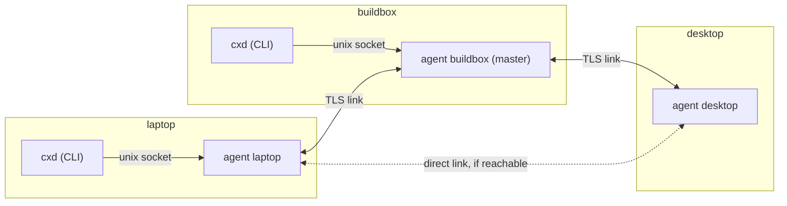

# Design: the broker transport

Status: proposed. Implementation follows in small pull requests (see the end of this document).

`cxd` reaches other machines over ssh. Each operation is one `ssh <alias> cxd _rpc`, and `cxd watch` holds a stream open. That works well, but every pair of machines needs an ssh alias and a key. The broker adds a second transport: a small mesh of `cxd` agents, one per machine, that carries the same operations. Paired machines reach each other through it, and ssh stays as the automatic fallback.

The design follows the owner's requirement, in his words: *"Dual support, dynamic master - slave handling"*:

- **Dual support.** The broker and ssh both carry every operation, and `cxd` picks one per call.
- **Dynamic master.** One agent holds a lease as the master. When the lease lapses, the highest-priority reachable agent takes over. A recovered agent does not preempt the master.

## Goals

1. **Self-hosted.** Python standard library and TLS only: no third-party packages, services or relays, and nothing outside the machines you pair. Certificates come from the system `openssl` binary, a system tool like `ssh`, because the standard library cannot generate keys.
2. **One agent per machine** (`cxd agent`), running as the user. It owns this machine's identity, keeps links to the other members, and executes the operations addressed to this machine, exactly as `cxd _rpc` does today.
3. **Pairing a machine takes two commands:**
   - `cxd join <addr>` on the new machine shows a short code;
   - `cxd accept <code>` on *any* member admits it.
4. **Dynamic master with a lease.** When the lease lapses, the highest-priority reachable member promotes itself. There is no preemption.
5. **At-least-once delivery** of every request, with ids and deduplication, so retries (including a retry over ssh) never execute an operation twice.
6. **Automatic ssh fallback** when no master is reachable, or when the target cannot be reached through the broker.
7. **Same commands.** The broker plugs in behind the existing `Transport` interface (`call`, `stream`), so `cxd start/send/watch/stop/resume/list/doctor` do not change.

## Non-goals

- **No NAT traversal or relays on the internet.** Members must reach each other directly, on a LAN or a VPN. One direction is enough (see Links).
- **No multi-user meshes.** All members belong to one person; the trust boundary is your own machines (see Threat model).
- **No consensus-grade replication.** With two machines there is no majority. The design accepts a short split brain during a partition and heals it deterministically (see Lease and election).

## Terms

| Term | Meaning |
| --- | --- |
| member | a machine admitted to the mesh; it runs one agent |
| node id | a member's stable id: the SHA-256 fingerprint of its certificate, hex |
| name | the member's `cxd` host name (`self` in config.json), used in commands |
| link | one TLS connection between two members, usable in both directions |
| master | the member holding the current lease |
| term | a counter that grows with every new lease holder; it orders masters |
| request | one operation (`op`, `args`) addressed to a member, with a unique id |

## Architecture



- **The CLI talks only to its local agent**, over a unix socket at `~/.cxd/agent/agent.sock` (mode 600, inside the mode 700 home). File permissions do the authentication, exactly as for the rest of `~/.cxd`.
- **Agents talk to each other over TLS links** with mutual authentication (below).
- **Routing.** A request from the laptop to buildbox goes over a direct link when one exists, and through the master otherwise. The master relays: it forwards requests and replies between links it holds.
- **Execution.** The target agent runs the operation with the same `state.OPS` functions that `cxd _rpc` uses, and streams `state.stream()` for `watch`.

### Links

A link is a long-lived TLS connection. Either side may have dialed it; once up it carries traffic both ways. Every agent keeps trying (with backoff, every 2 to 60 seconds) to keep a link to:

- the master, always;
- every other member whose address it knows, best effort.

Because one direction is enough, a member that accepts no inbound connections still works. Two examples: a WSL2 instance behind Windows NAT, or a laptop behind a firewall. The other side dials it, or both dial the master.

Members advertise the addresses they listen on (`listen` in config.json, for example `0.0.0.0:47100`). Each member also remembers the address it last saw a peer connect from.

## Identity and TLS

- **Keys.** On first use, each agent creates an EC P-256 key and a self-signed certificate, valid for 10 years, in `~/.cxd/agent/` (`key.pem` mode 600, `cert.pem`):

  ```text
  openssl ecparam -name prime256v1 -genkey -noout -out key.pem
  openssl req -new -x509 -key key.pem -out cert.pem -days 3650 -subj /CN=cxd-agent
  ```

  Both OpenSSL and LibreSSL (macOS) accept these commands. The node id is the SHA-256 of the certificate's DER encoding.
- **Pinning, not a CA.** Each member keeps the certificates of all members in `~/.cxd/agent/members.json` and writes them into a CA bundle, `~/.cxd/agent/trust.pem`. Both TLS contexts load that bundle and require a peer certificate (`CERT_REQUIRED`), so only member certificates complete a handshake. A self-signed certificate is its own CA, so the standard verification is exact pinning. Host names are not checked; the pinned certificate *is* the identity.
- **Protocol floor: TLS 1.2.** The `python3` that ships with macOS is linked against LibreSSL 2.8, which has no TLS 1.3. Ciphers are restricted to ECDHE key exchange with AES-GCM or ChaCha20-Poly1305. TLS 1.3 is negotiated where both sides support it. Compression and renegotiation are off.
- **After the handshake**, each side checks that the peer's node id is in `members.json` and not revoked, then exchanges a `hello` (below).

## Pairing: `cxd join` and `cxd accept`

Pairing has to work before the new machine is trusted, so it uses a separate, deliberately small path.

1. **Joiner connects.** On the new machine, `cxd join <addr>` creates the agent identity if needed and connects to `<addr>` (any member's listen address) with TLS. It presents its certificate but does not verify the member's, because it does not know it yet. The member's join context accepts any client certificate and allows exactly one operation on such a connection, `join`.
2. **Joiner requests.** The joiner sends `{"t": "join", "name", "cert": <PEM>, "nonce_j"}`. The member answers `{"nonce_m", "member_fp": <its own node id>}` and records a **pending join**:
   - the joiner's certificate fingerprint as the member saw it on the TLS connection;
   - the name and both nonces;
   - an expiry of 10 minutes.

   The pending join is replicated to all members through the master.
3. **Both sides compute the short code**, independently:

   ```text
   code = base32( SHA-256( "cxd-join-v1" | member_fp | joiner_fp | nonce_m | nonce_j ) )[:10]
   ```

   Each side uses the fingerprints *as it observed them on the TLS connection*:
   - the joiner uses the certificate the member presented, plus its own;
   - the member uses its own certificate, plus the one the joiner presented.

   The joiner shows the code grouped as `ABCDE-FGHJK` and waits.
4. **A human accepts.** On any member, `cxd accept ABCDE-FGHJK` looks for a pending join whose code matches.
   - If one matches, the joiner's certificate is added to the members, with priority below every existing member unless `--priority` says otherwise. The new membership is published through the master.
   - If none matches, nothing happens, and the command says so.
5. **The joiner completes.** The joiner's waiting connection receives the full member list (certificates, names, addresses, priorities), writes `members.json` and `trust.pem`, and from then on connects like any member.

**Why the code.** A man in the middle between joiner and member has to present its own certificate to each side, so the two sides compute codes from different fingerprints and the codes differ. The human compares what the joiner shows with what `accept` checks. 10 base32 characters are 50 bits, so a guessed or forced match is out of reach within the 10-minute window. A member also rate-limits pending joins: at most 5 at a time, and the oldest is dropped first. A wrong code is never confirmed to the joiner side.

**Leaving.** `cxd members remove <name>` (on any member) revokes a member. Its fingerprint is removed from every `trust.pem` through the master, and its links are closed.

## Lease and election

Membership and the lease are the only replicated state. They live in `~/.cxd/agent/state.json`:

```text
{ "version": n, "members": [{node_id, name, cert, addrs, priority, revoked}], "pending_joins": [...],
  "lease": {"term": t, "master": node_id, "expires": <unix time> } }
```

- **Holding the lease.** The master holds the lease for `LEASE = 15 s` and renews it every `LEASE / 3`. It sends the renewal (term, master, expiry) over every link, and members forward lease messages they receive to their other links.
- **Who may change state.** Only the master changes membership: accept, remove, and priority changes. Each change bumps `version` and is pushed to every member, which keeps the highest version it has seen for the current term.
- **When the lease lapses.** A member that has heard no renewal for `LEASE + skew` (skew 3 s) treats the lease as lapsed. It then checks which members it can reach: itself, plus every member with a live link that answers a `ping` within 2 s. If it has the highest priority among those (ties go to the lower node id), it promotes itself with `term + 1`. Otherwise it waits one more `LEASE` for the winner's renewal before checking again.
- **No preemption.** A member never takes over while it hears valid renewals, even from a master with lower priority. A recovered high-priority member joins as a follower.
- **Split brain and healing.** In a partition each side can elect a master; with two machines it always will. When links come back and two masters see each other:
  - the higher term wins;
  - with equal terms, the higher priority wins, then the lower node id;
  - the other steps down at once.

  Membership changes made on the losing side during the partition are merged by version per member entry: a revocation always wins.

  Routing never depends on there being exactly one master. Requests carry their target and travel over any path that reaches it, so a split brain only affects which member relays.
- **Clocks.** Expiry times are absolute but compared with the receiver's own clock. A member that sees an expiry more than `LEASE` in the future clamps it to `now + LEASE`. Clock skew therefore shortens or lengthens a lease by at most the skew, and never blocks failover.

## Delivery: at-least-once, deduplicated

Every request carries an id: 128 random bits, hex. The client generates it once per logical operation and reuses it for every retry, including a retry over ssh.

- **Retry until answered.** The origin agent keeps the request until it has the reply. It resends over a new path when a link drops or the master changes, with backoff, until the caller's timeout.
- **Deduplicate at the target.** The target agent records each executed request id with its reply in `~/.cxd/dedupe/<id>.json` before it answers. A request whose id is already recorded is answered from the record and not executed again. `cxd _rpc`, the ssh path, uses the same store. So a request that reached the target through the broker, and is retried over ssh after the broker reply was lost, runs once. Records expire after 24 hours, and the store is pruned like sessions.
- **Streams.** `watch` already resumes from a cursor that the host owns. Over the broker, a stream carries the same messages (`hello`, `event` with cursor, `keepalive`, `end`). After any break, on either transport, the client resumes from its last cursor. That is the existing guarantee: no lost or repeated events, and only the owning host can report an exit.
- **Ordering.** Requests from one client to one target are executed in the order the client issued them, because the CLI waits for each reply. Concurrent clients get no ordering guarantee, which is also true over ssh.

## Transport selection and ssh fallback

`hosts.<name>.transport` in config.json takes one of three values:

| Value | Behaviour |
| --- | --- |
| `ssh` | as today |
| `broker` | broker only. When unreachable the call fails with exit 4, so nothing is decided. |
| `auto` | Default for a host that is a mesh member and also has ssh settings. It tries the broker first, and falls back to ssh **for that call** when any of these holds: the local agent is not running; no master is reachable and there is no direct link to the target; the target is not linked; or the broker attempt times out (`broker_timeout`, default 10 s). The fallback reuses the request id, so the target's dedupe store prevents a double execution. `watch` switches transports between reconnects in the same way. |

`cxd list`, `cxd doctor` and `cxd watch` show which transport carried each call, for example `via broker (master buildbox)` or `via ssh (broker: no master reachable)`.

## Protocol

- **Framing.** Each message is one JSON object per line (UTF-8, `\n`-terminated), at most 8 MiB. A larger frame closes the link. Every message has a type `t`.
- **Session start.** The first message on a link is a `hello` from each side, carrying:
  - `v`, the broker protocol version (1);
  - `node` and `name`;
  - `term` and `version`, the sender's view of the lease and membership;
  - `listen`, its advertised addresses.

  Mismatched protocol versions close the link with a reason.

| `t` | Direction | Fields |
| --- | --- | --- |
| `hello` | both | see above |
| `lease` | master to all, forwarded | `term`, `master`, `expires` |
| `state` | master to all | full replicated state (on version change, and on demand) |
| `ping` / `pong` | both | `id` |
| `req` | origin to target, via relays | `id`, `from`, `to`, `op`, `args`, `ttl` (hops left, starts at 4) |
| `rep` | target to origin | `id`, `ok`, `result` or `error` and `code` |
| `stream` / `end` | target to origin | `id`, `msg` (one `state.stream()` message) |
| `cancel` | origin to target | `id`: the client is gone, so stop the stream |
| `join` / `joined` | joiner and member, join context only | see Pairing |
| `accept` | any member to master | `code`, `priority` |

The local unix socket uses the same framing with two message types:
- `call` (`op`, `args`, `to`, `id`), answered by `rep`;
- `open` (stream), answered by `stream` and `end`.

## Command line and configuration

```text
cxd agent [start|stop|status|run]   run (foreground) is for systemd/launchd; start daemonizes
cxd join <addr> [--name NAME]       on the new machine; prints the code and waits for acceptance
cxd accept <code> [--priority N]    on any member
cxd members [--json]                members, priorities, links, master, term
cxd members remove <name>
cxd members priority <name> <N>
```

New keys in `~/.cxd/config.json`:
- `listen` (addresses to listen on; default none, so outbound only);
- `priority` (this machine's own, used when it creates a mesh);
- per host: `transport` (`auto`, `broker` or `ssh`) and `broker_timeout`.

`cxd doctor` gains checks for the agent: running, identity present, member of a mesh, links up, master known, and lease fresh.

## Operations

- **Running the agent.** Run `cxd agent start` once per machine, or install `cxd agent run` as a user service (systemd `--user` unit, or a launchd agent). The documentation ships both unit files.
- **Ports.** A machine needs an open TCP port only if it should accept inbound links. One reachable member is enough for the mesh to form.
- **A WSL2 machine** in NAT mode accepts no inbound connections unless Windows forwards the port. It can still be a member, and even the master, by dialing out.
- **Logs.** Logs go to `~/.cxd/agent/agent.log`, rotated at 5 MiB. They never contain message text, only ids, ops and sizes.

## Threat model

**Assets.**
- The ability to start, steer and stop Claude Code sessions on your machines. Through a worker with permissions, that is the ability to run commands.
- Message and report contents.
- The agent private keys.

**Trust boundary.** Members are your own machines under your own user. Anyone who can act as your user on a member already has full control of that member, and through `cxd` (and ssh) of the others. The broker must not widen this to anyone else.

| Threat | Mitigation |
| --- | --- |
| Someone on the network connects to an agent port | Mutual TLS with pinned member certificates. Without a member key, no handshake completes, except on the join path, which allows nothing but `join`. |
| Someone joins themselves | A join stays pending until a human types the code shown on the joiner's screen into `cxd accept` on a member. The code is not guessable (50 bits, 10-minute expiry, at most 5 pending). |
| A man in the middle during pairing | The code binds both TLS certificates as each side observed them. A man in the middle yields different codes on the two sides, so `accept` fails. |
| A stolen member key | Remove the member (`cxd members remove`). Its fingerprint leaves every trust bundle and its links are closed. The key file is mode 600, so stealing it already requires your user account on that machine. |
| A malicious or compromised member | Out of scope by definition: a member is you. Revoke it as above. Relays see request contents; they are members too. |
| Replay of captured traffic | TLS prevents replay on the wire. A replayed request id inside a valid link is answered from the dedupe store and not executed again. |
| Flooding and oversized messages | Frames are capped at 8 MiB, the join path is rate-limited, and links that send malformed frames are closed. |
| Requests looping between relays | Each request carries a hop counter (`ttl`, 4), and relays drop requests they have already forwarded (by id). |
| A downgrade to weak TLS | TLS 1.2 is the minimum, with only ECDHE plus AEAD cipher suites, and renegotiation and compression off. |
| The local socket used by another user | `~/.cxd` is mode 700 and the socket is mode 600. Only your user (and root) can reach it, the same rule that protects inboxes and FIFOs today. |
| Information in logs | Logs record ids, ops, sizes and timings only, never message text or tokens. Secrets do not belong in messages anyway (README, Security model). |
| A US-hosted or other third-party relay | None exists: agents connect only to member addresses you configure. Pairing and traffic never leave your machines and your network. |

**Residual risks.**
- **Split brain.** During a partition, two members may each act as master. The only effect is on which member relays. Healing is deterministic (term, priority, node id).
- **Accepting the wrong machine.** A human who accepts a code they did not verify on the joining machine admits whatever machine produced it. The `accept` output therefore shows the joiner's name and the address it connected from, and asks for confirmation.

## Testing and evidence

- **Unit tests.** All of these run agents on localhost under separate `CXD_HOME`s, ports and identities, with the stub claude:
  - framing limits;
  - the dedupe store, shared with `_rpc`;
  - the join code, including a simulated man in the middle;
  - the lease and election: a lease that lapses, priority order, no preemption, split-brain healing by term;
  - relaying, and retries with dedupe;
  - the auto transport and its ssh fallback;
  - watch resuming across a transport switch.

  Every guard gets a mutation in `tests/mutate.py`.
- **Real nodes.** These steps run on two real machines, one Linux and one macOS, with logs kept in `docs/evidence/`:
  1. pair the two;
  2. run start, send, watch, stop and resume through the broker;
  3. kill the master's agent and show that the other machine promotes and the work carries on;
  4. restart the old master and show that it does not preempt;
  5. block the broker port and show the ssh fallback, with no operation executed twice.

## Implementation plan

1. This design document.
2. `lib/cxd/broker/identity.py`: key and certificate generation through `openssl`, fingerprints, and the two TLS contexts.
3. `lib/cxd/broker/wire.py` (framing) and `lib/cxd/dedupe.py` (the store, wired into `cxd _rpc`, and request ids in `SshTransport`).
4. The agent core: links, the local socket, request execution and relaying, with a static master.
5. Pairing: `cxd join` and `cxd accept`, the code, and pending joins.
6. The lease and election, healing, and `cxd members`.
7. `BrokerTransport` and the `auto` transport with ssh fallback, plus doctor checks.
8. The service unit files, the documentation, and the real-node evidence.
