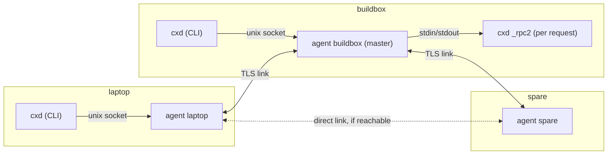

# Design: the broker transport

**Status:** proposed, revision 6 (after five reviews). Implementation follows in small pull requests; see the end of this document.

`cxd` reaches other machines over ssh. Each operation is one `ssh <alias> cxd _rpc`, and `cxd watch` holds a stream open. That works well, but every pair of machines needs an ssh alias and a key.

The broker adds a second transport: a small mesh of `cxd` agents, one per machine, that carries the same operations. Machines that have paired reach each other through it, and ssh stays as the automatic fallback.

The design follows the owner's requirement, in his words: *"Dual support, dynamic master - slave handling"*:

- **Dual support.** The broker and ssh both carry every operation, and `cxd` picks one per call.
- **Dynamic master.** One agent holds a lease as the master. When the lease lapses, the highest-priority reachable agent takes over. A recovered agent does not preempt it.

## Goals

1. **Self-hosted.** Python standard library and TLS only: no third-party packages, no third-party services, no relays outside the paired machines. The system `openssl` binary is a system tool like `ssh`; it generates the certificates, because the standard library cannot generate keys.
2. **One agent per machine** (`cxd agent`), running as the user. It owns this machine's identity, keeps links to the other members, and has the operations addressed to this machine executed exactly as `cxd _rpc` executes them today.
3. **Pairing a machine takes two commands at a terminal:**
   - `cxd join <addr>` on the new machine shows a short code.
   - `cxd accept <code>` on *any* member admits it, and shows a confirmation code that the human types on the new machine.
4. **A dynamic master with a lease.** When the lease lapses, the highest-priority reachable member promotes itself. There is no preemption: a restarted, reconnecting or waking member never takes over from a master that is serving.
5. **At-least-once delivery** of every request, with ids and deduplication. A retry, including one over ssh, never executes an operation twice.
6. **Automatic ssh fallback** when no master is reachable, or when the broker cannot reach the target.
7. **Same commands.** The broker plugs in behind the existing `Transport` interface (`call`, `stream`), so `cxd start/send/watch/stop/resume/list/doctor` do not change.

## Non-goals

- **NAT traversal, and relays on the internet.** Members must reach each other directly, on a LAN or a VPN. One direction per pair is enough (see Links).
- **Multi-user meshes.** All members belong to one person. The trust boundary is your own machines (see Threat model).
- **Consensus-grade replication.** With two machines there is no majority. The design keeps a single master in the normal cases: a restart, a member that reconnects, and a member that wakes from sleep. A partition can briefly produce two masters, and that heals deterministically and without preemption (see Lease and election).

## Terms

| Term | Meaning |
| --- | --- |
| member | a machine admitted to the mesh; it runs one agent |
| node id | a member's stable id: the SHA-256 fingerprint of its certificate's DER, in hex |
| name | the member's `cxd` host name (`self` in config.json), used in commands; unique in the mesh |
| link | one TLS connection between two members, usable in both directions |
| master | the member holding the current lease |
| term | a counter that grows with every new regular lease holder and orders masters |
| request | one operation (`op`, `args`) addressed to a member, with a unique id |
| attempt | one delivery of a request over one path; a retry is a new attempt with the same request id |

## Architecture



- **The local socket.** The CLI talks only to its local agent, over a unix socket at `~/.cxd/agent/s`. The name is short because macOS limits socket paths to 104 bytes. The socket has mode 600 inside the mode 700 home, so file permissions do the authentication, as for the rest of `~/.cxd`.
- **Links.** Agents talk to each other over mutually authenticated TLS links (below).
- **Routing.** A request takes the first next hop that exists:
  1. a direct link to the target;
  2. the master;
  3. any member that reports a link to the target. Members list their live links in `hello` and in state messages.

  When no hop exists, the node that has the request answers `unreachable` at once, back to the origin by node id: the origin itself, or a relay (the master, typically) that has no link to the target. So `auto` falls back to ssh without waiting, also when the target is a laptop that is closed.
- **Execution: the agent runs `cxd _rpc2`.** For each request addressed to its machine, the agent starts the installed CLI, `~/.cxd/bin/cxd _rpc2` (`_rpc` for read-only requests and streams), and speaks to it over stdin and stdout exactly as `SshTransport` does over ssh (see Delivery). So the broker and ssh execute operations with the same code and the same claim store, and an agent that has run for days still executes requests with the `cxd` that is installed now, for example after a plugin update. For `watch`, the child streams `state.stream()`.
- **One agent per machine.** An agent holds `~/.cxd/agent/lock` (flock) while it runs, so a second agent on the same machine exits at once.
- **Version check.** The agent's own code (links, lease, routing) is the code it was started with. `cxd doctor` warns when the agent's version differs from the installed `cxd`. Restart the agent to pick up the new code.

### Links

A link is a long-lived TLS connection. Either side may have dialed it; once up, it carries traffic both ways.

**Who dials.** Every agent keeps trying to keep a link to the master, always, and best effort to every other member whose address it knows.
- **Backoff.** While an agent has no link at all, it redials every member it knows with a backoff from 1 to 5 seconds, so that a member that restarts behind NAT links up well within its grace period (see Lease and election). Once it has a link, it retries the others with a backoff from 2 to 60 seconds.

**Liveness.** Each side sends a `ping` on an idle link every `LEASE / 3` seconds. A link that has carried nothing, not even a `pong` or part of a frame, for `LEASE` seconds is closed and redialed. This catches TCP connections that died silently, for example while a laptop slept.

**Link changes travel.** When a member's set of live links changes, it sends `{"t": "links", "node", "links", "seq"}` to all its links, and members forward it while its `seq` is newer, like a renewal. So routing rule 3 stays current without waiting for a membership change.

**Control first.** Each link has a send queue in which control frames (`lease`, `lease_ok`, `ping`, `pong`, `hello`, `links`, `unreachable`, and the small per-request frames `accepted`, `go`, `running` and `cancel`) go before data. A data message over 256 KiB is sent as `part` frames of 256 KiB, so a large request on a slow link never holds a renewal back for long; the receiver reassembles them, up to the 8 MiB limit.

**One direction is enough.** A member that accepts no inbound connections still works, because the other side dials it or both dial the master. Examples are a WSL2 instance behind Windows NAT, or a laptop behind a firewall.

**Addresses.**
- `listen` in config.json (for example `0.0.0.0:47100`) is what the agent binds.
- `advertise` (for example `<lan address>:47100`, or the Windows host address and forwarded port for WSL2) is what it tells other members. A wildcard is never advertised.
- Each member also remembers the IP address a peer last connected from, and dials it at the peer's advertised port (the source port of an inbound connection cannot be dialed back).

**Checks.** A dialer checks that the peer's node id is the member it meant to reach. A `hello` whose node is the agent itself, which happens when it dialed one of its own addresses, closes the link.

## Identity and TLS

**Keys.** On first use each agent creates an EC P-256 key and a self-signed certificate in `~/.cxd/agent/`: `key.pem` (mode 600) and `cert.pem`. Creation holds a lock, so two first users get one identity. Loading checks that the key belongs to the certificate; a corrupt or mismatched pair is an error that says how to recover, and is never replaced silently, because a new key means a new node id and a new pairing.

The certificate's subject is unique (`CN=cxd-<16 random hex>`), its validity starts a day before it was made and lasts 10 years, and openssl gets an explicit config, so the result does not depend on the system's `openssl.cnf`:

```text
openssl ecparam -name prime256v1 -genkey -noout -out key.pem
openssl req -new -key key.pem -out req.csr -config cxd.cnf
openssl ca -batch -selfsign -config cxd.cnf -extensions cxd -keyfile key.pem -in req.csr \
    -out cert.pem -notext -startdate <yesterday> -days 3650
# cxd.cnf, written per agent: [req] prompt=no, CN in [dn]; a throwaway [ca] database;
#   [cxd] basicConstraints=critical,CA:TRUE  keyUsage=critical,digitalSignature,keyCertSign
#         subjectKeyIdentifier=hash  authorityKeyIdentifier=keyid:always
```

- `openssl ca -selfsign` is the portable way, in OpenSSL and LibreSSL alike, to set the start of the validity period. The early start means a peer whose clock lags, as happens after a laptop sleeps, still accepts a fresh certificate.
- The CN goes in the config, not `-subj`: LibreSSL ignores `-subj` when the config sets `prompt = no`.
- Unique subjects and key identifiers let OpenSSL pick the right anchor out of a bundle of several self-signed certificates. With identical subjects and no key identifier it tries only the first one, and every other member fails verification.
- The node id is the SHA-256 of the certificate's DER encoding. A PEM that holds anything other than exactly one certificate has no node id.

This is implemented in `lib/cxd/broker/identity.py`. It was tested on OpenSSL 3.6 with Python 3.14, and on macOS's LibreSSL 2.8.3 with Python 3.9.6. Members pinned through one bundle all verify; a client without a certificate completes a `CERT_OPTIONAL` handshake and is seen as having none; strangers are refused in both directions; a certificate signed by a member passes TLS but not the pin.

**Pinning: the node id, checked after the handshake.**
- **Trust bundle.** Each member keeps the certificates of all non-revoked members in the replicated state (below). It writes them, atomically and mode 600, to a CA bundle, `~/.cxd/agent/trust.pem`. The bundle always holds the machine's own certificate, so a machine in no mesh yet has one and can listen for joins.
- **Verification.** TLS verifies the peer against that bundle, so only member certificates complete a handshake. The certificates are CAs (`CA:TRUE`; LibreSSL 2.8 builds no chain to a self-signed certificate without `keyCertSign`), so one could sign others. Pinning therefore rests on the mandatory check after the handshake. `classify()` gives a server-side peer one of three verdicts:
  - **member**, when the SHA-256 of its certificate is a current member's node id;
  - **joiner**, when it presented no certificate;
  - **refuse**, for anything else.

  A dialer compares the node id with the member it dialed. Both checks have tests and mutations.
- **Host names** are not checked: the pinned certificate *is* the identity.
- **Rebuilding.** An `SSLContext`'s trust store only grows, so the agent builds new contexts after every membership change and closes links whose peer is no longer trusted.

**One listener, two kinds of client.** The server context uses `CERT_OPTIONAL` with the trust bundle loaded:
- a member presents its pinned certificate, which must verify;
- a joining machine presents **no** certificate, and its connection may carry only `join` messages.

A client certificate that fails verification aborts the handshake. Under TLS 1.3 the client notices only at its first read, so the client treats a closed link right after the handshake as an authentication failure.

**Protocol floor: TLS 1.2.** The `python3` that ships with macOS is linked against LibreSSL 2.8, which has no TLS 1.3.
- **Ciphers** are restricted to ECDHE key exchange with AES-GCM or ChaCha20-Poly1305.
- **TLS 1.3** is used where both sides support it.
- **Compression and renegotiation** are disabled (`OP_NO_COMPRESSION`, and `OP_NO_RENEGOTIATION` where Python offers it).

**After the handshake** each side checks that the peer's node id is a member and not revoked. Then both exchange a `hello` (see Protocol).

**Frames.** Before authentication a frame may be at most 64 KiB, and a joining connection may send at most 4 frames. After authentication the limit is 8 MiB.

## Pairing: `cxd join` and `cxd accept`

Pairing has to work before the new machine is trusted, so it uses a separate, small path. That path ends only after a human has confirmed on both machines: the member side accepts a code that the joiner shows, and the joiner side types a code that the member shows.

**Both commands need a real terminal.** `cxd join`, `cxd accept`, `cxd members remove` and `cxd members priority` read their confirmation from `/dev/tty` and refuse without one. The agent does not take the CLI's word for it: it accepts these changes on its socket only from a process that has a controlling terminal, which it checks itself (the peer's pid from `SO_PEERCRED` on Linux or `LOCAL_PEERPID` on macOS, then that process's terminal). A raw write to the socket from a process without a terminal is refused like the CLI would be.

This stops the common case: a session that has been prompt-injected ("run `cxd accept ABCDE-FGHJK`") and runs commands through Claude Code's Bash tool, which has no controlling terminal (checked: opening `/dev/tty` there fails with ENXIO). The implementation verifies that on both platforms. It does not stop a session that deliberately allocates a pty (`script`, Python's `pty`) or drives a terminal that already exists (`tmux send-keys`, `screen -X stuff`, `osascript` telling Terminal to type); see Threat model.

1. **Joiner connects.** On the new machine, `cxd join <addr>`:
   - refuses if this machine is a member of a mesh with other members (a machine that is the only member of its own mesh leaves it first; see The first member), unless `--reset` is given: that discards the old mesh state and makes a new key, which a machine that was removed from its mesh needs, since its old node id stays revoked;
   - creates the agent identity if needed;
   - connects to `<addr>`, any member's advertised address, with TLS and **without** a client certificate. It does not verify the member's certificate yet, but records its fingerprint `member_fp_seen`.
2. **Commit.** The joiner sends `{"t": "join", "name", "cert": <its PEM>, "commit": SHA-256(nonce_j)}`, where `nonce_j` is 32 random bytes.
3. **Member's nonce.** The member checks that the joiner's node id is not revoked and that its name is valid (the rules for `cxd` host names: lowercase letters, digits and dashes, at most 32 characters, not `local` and not a name the member itself answers to) and free, and records a pending join with:
   - the joiner's node id `joiner_fp` (the SHA-256 of its certificate's DER), its name and address, and the commit;
   - its own node id `member_fp`;
   - an expiry of 10 minutes.

   It answers `{"t": "nonce", "nonce_m"}` with 32 random bytes. The joiner never trusts a fingerprint sent in a message, only what TLS showed it.
4. **Reveal.** The joiner sends `{"t": "reveal", "nonce_j"}`. The member checks it against the commit and drops the pending join on a mismatch.
5. **The join code.** Both sides compute:

   ```text
   transcript = member_fp | joiner_fp | nonce_m | nonce_j
   join_code    = base32( SHA-256( "cxd-join-v2"    | transcript ) )[:10]
   confirm_code = base32( SHA-256( "cxd-confirm-v2" | transcript ) )[:10]
   ```

   - The joiner uses `member_fp_seen` and its own fingerprint.
   - The member uses its own node id and the node id of the certificate in the message.

   The joiner shows the join code as `ABCDE-FGHJK`, with the member's name and address, and asks for the confirmation code.
6. **Accept.** On any member, `cxd accept ABCDE-FGHJK` looks for a pending join with that code. It shows the joiner's name, the address it connected from, and its fingerprint, then asks for confirmation at the terminal. Accepting marks the pending join *accepted* (with priority below every existing member unless `--priority` says otherwise) and shows the confirmation code, `KLMNP-QRSTV`. Nobody trusts the joiner yet.
7. **Joiner confirms.** The member that holds the joiner's connection sends `{"t": "accepted_join", state}`: the mesh as it will be with the joiner in it. The joiner keeps it unapplied until the human types the confirmation code. When the typed code equals the joiner's own `confirm_code`, and the state lists `member_fp_seen` as a member and the joiner itself under its name, the joiner answers `{"t": "confirmed", "mac": SHA-256("cxd-confirmed-v2" | transcript | confirm_code)}`. A wrong code may be retyped twice; the third mismatch aborts the join.
8. **Commit.** The `mac` is the joiner's consent, not proof that any human acted: the joiner knows everything the confirmation code is made of. The human action on the member side is `cxd accept`. So the member commits only when all of these hold: the pending join is marked accepted, it already sent `accepted_join` on this very connection, and the `mac` matches the transcript and the confirmation code. A `confirmed` that arrives before the member sent `accepted_join` drops the pending join and closes the connection. Then the master adds the joiner to the membership, and the member sends `{"t": "joined", state}`; the joiner writes the state and its trust bundle and from then on connects like any member. If the joiner aborts, mistypes three times, or its connection drops before `confirmed`, the pending join is dropped and no member ever trusted it: a retry starts again from `cxd join`.

**Why this is safe.**
- **A man in the middle** must show its own certificate to each side, so the two sides compute different transcripts. The real member has no pending join with the code that the joiner shows, so `accept` there finds nothing. The man in the middle can send the joiner an `accepted_join` state of its own, but cannot make the real member show the matching confirmation code: the joiner sends no `confirmed` and installs nothing until the human types that code, and it accepts `joined` only after its own `confirmed`.
- **Grinding the codes is impossible.** The joiner commits to its nonce before it sees the member's, and the member's nonce is fixed before the joiner reveals. A man in the middle cannot search for nonces that make the codes on the two sides match, so its chance per attempt is 2^-50.
- **Each attempt costs a pending join**, which a human must also accept.

**Limits.**
- **Per member.** A member keeps at most 5 pending joins. When full it refuses new ones rather than evicting old ones, so a flood cannot push out a real join.
- **Tied to the connection.** A pending join lives only while the joiner's connection stays open, so a host cannot park joins and walk away. `cxd members pending` lists them and `cxd members pending --clear` drops them. While a human walks from one machine to the other, the member keeps the connection alive with TCP keepalive (no frames, so nothing counts against the joiner's frame limit); the connection is closed at the 10-minute expiry.
- **Per address.** It accepts at most one join attempt per source address every 10 seconds.
- **One per address.** A source address has at most one pending join, so one host cannot fill all five places.
- **Replication.** Pending joins, transcripts included, are replicated through the master, so that `accept` works on any member. When the joiner's connection drops, the member that held it tells the master, which drops the pending join everywhere. Without a reachable master, `accept` works only on the member that received the join, and only when that member creates the mesh (the first member) or the master is back by the time the joiner confirms: membership changes always go through a master.

**The first member.** A machine with `listen` set accepts joins before it belongs to any mesh. Its first `cxd accept` (confirmed as above) creates the mesh, with itself as the master at term 1 and the joiner as the second member. `cxd join` on a machine that is the only member of its mesh leaves that mesh and joins the new one.

**Leaving.** `cxd members remove <name>`, on any member, revokes a member (see Revocation).

## Replicated state

Each agent keeps one state file, `~/.cxd/agent/state.json`:

```text
{ "members": { node_id: {name, cert, advertise, priority, rev} },
  "revoked": { node_id: {name, at} },
  "pending_joins": [ ... ],
  "lease": {"term": t, "master": node_id, "provisional": bool} }
```

- **Membership entries** carry a version `(term, regular, rev, writer)`, where `regular` is 1 when a regular master wrote the entry and 0 when a provisional one did. Only a master changes membership; `accept` and `priority` need a reachable master, and say so when there is none. Merging keeps, per member, the entry with the higher version, compared in that order: the term first, so a deposed master's later edits never beat the elected master's; then regular over provisional, so a provisional master of the same term never overrides a regular one; and the writer last, so two masters of a split cannot produce a tie. `hello` and `state` carry the full versions, so a split is noticed when links come back.
- **Names are unique.** An `accept` whose name is taken is refused. If two masters of a split each admitted a machine under the same name, the merge keeps both members (they have different node ids), marks the name as a conflict, and `cxd doctor` and `cxd members` ask the user to remove one; until then, that name resolves to neither.
- **Links.** The master's state messages also list which members have live links to which, for routing.
- **Revocation is sticky and needs no master.**
  - `cxd members remove` adds the node to `revoked` locally at once and drops its links. The revoked node is removed from the trust bundle.
  - Revocations travel in every `hello` and every state message, and merge by union, whatever the term.
  - A revoked node id is never trusted again. Re-pairing the machine creates a new key, and so a new node id.
  - Every lease or state message that comes from, or names as master, a revoked node is ignored.
  - A member that sees its own node id revoked stops its agent and says why in its log and in `cxd doctor`.
  - **Revoking an offline member.** The revoked machine never hears of it, because every member now refuses its handshake. Its agent keeps redialing with backoff; once every known member has refused its certificate for an hour, `cxd doctor` on that machine reports "refused by every member: this machine was probably removed from the mesh".

## Lease and election

**Clocks.** Lease timing uses a clock that keeps counting while the machine sleeps where there is one: `CLOCK_BOOTTIME` on Linux, and `CLOCK_MONOTONIC` on macOS (which, unlike Linux's, counts sleep). Python's `time.monotonic()` stops during suspend on both. Under WSL2, `CLOCK_BOOTTIME` does not count the host's sleep either (checked on the WSL2 test machine: it equals `CLOCK_MONOTONIC`, and the boot time it implies is off by the hours Windows slept). Durations between machines are always sent as seconds remaining, never as absolute times, so wall clocks are never compared between machines.

**Wakes.** An agent, whatever its role, treats either of these as a *wake*:
- a gap of more than `LEASE / 2` on the lease clock between two of its loop ticks (sleep on Linux and macOS, where that clock counts it; also a long stall of the process);
- a forward jump of the wall clock (`time.time()`) of more than `LEASE / 2` beyond what the lease clock moved since the last tick (sleep under WSL2, once the host corrects the wall clock; also a stepped clock). It checks this on every tick and again just before it sends a renewal or a `hello`. A wall clock stepped backwards is ignored.

On a wake, a master becomes provisional with `provisional_for` 0, and every agent enters grace (below). The agent logs each wake, with its length, so long-running real nodes show it.

A wake detected by the wall clock comes only once the host has corrected that clock, which under WSL2 can be late. The rule below (*lapse witnesses*) therefore does not depend on it: the members whose clocks kept running decide.

**The lease.**
- **Identity.** A lease is `(term, master, incarnation)`. The incarnation is a random number an agent picks every time it starts, so a restarted agent's renewals are never mistaken for, or discarded as older than, those of its previous run. Renewals carry a `seq` that grows within one incarnation.
- **Holding it.** The master holds a lease of `LEASE = 15 s` and renews it every `LEASE / 3`. A renewal `{"t": "lease", "term", "master", "incarnation", "provisional", "provisional_for", "seq", "remaining"}` carries the seconds left. A receiver sets its own deadline to its own clock plus `remaining`.
- **Confirmation.** Members answer each renewal with `{"t": "lease_ok", "term", "master", "incarnation", "seq", "seen_term", "lapsed"}`. A regular master that has had no `lease_ok` from any member for `LEASE` becomes provisional at the same term. A regular master is therefore always one that a member confirmed within the last lease period.
- **Lapse witnesses.** A member that saw a lease lapse on its own clock remembers it (`lapsed`: the last few `(term, master, incarnation)` it saw lapse) and sends that list in `hello`, `pong` and `lease_ok`. It never treats a lease it saw lapse as regular again: any later claim of it counts as provisional with `provisional_for` 0. A master that finds its own current lease in a peer's `lapsed` list becomes provisional at once, with `provisional_for` 0. So both sides of a link always agree on what the returning master is, whatever its own clock says.
- **`seen_term`.** Each member keeps the highest term it has seen in this mesh (in its state file; it starts again at 0 when the machine joins a mesh). It never confirms a *regular* lease below it. It confirms a *provisional* lease below it only when, after its grace, no lease at or above `seen_term` has been heard of for `LEASE + 3 s` (the master of that term is gone for good, or was revoked); the confirmed master then becomes regular at `seen_term + 1`.
- **A start is never a lease.** An agent always starts as a follower, also when its state file says it was the master: the saved term is only a lower bound for the terms it will accept and create. While an agent is in grace it says so in `hello` and `pong` (`grace: true`), and the others leave it out when they pick a candidate.
- **Forwarding.** Members forward a renewal to their other links only if its `(term, master, incarnation, seq)` is newer than what they have seen for that lease. That makes forwarding stop, and two masters at the same term never hide each other.
- **Lease views travel.** Every `hello` and `pong` carries the sender's current lease view (term, master, incarnation, provisional, `provisional_for`, the seconds left by its own clock) and its `lapsed` list. A member learns about a live lease the moment a link comes up.
- **Grace.** A member never promotes during its first `2 x LEASE` after it starts, and for `2 x LEASE` after a wake or after it leaves the alone state (below). In that time it dials (every few seconds, see Links), exchanges hellos, and learns the master. Grace does not stop a provisional master from being upgraded.

**Election.**
- **Lapse.** A member that has seen no renewal for `LEASE + 3 s` treats the lease as lapsed.
- **Pre-vote.** Before it promotes, a member asks every member it can reach (a live link and a `pong` within 2 s) for its lease view. If any of them reports a live lease, the member follows that master instead.
- **Promotion.** If no reachable member holds a live lease:
  - **With others:** if the member can reach at least one other member, the reachable member with the highest priority that is not in grace promotes itself to `max(term, seen_term) + 1`, ties going to the lower node id. Every other member waits `LEASE` for that member's renewal before it checks again.
  - **Alone: provisional.** If it can reach **no** other member, it promotes itself as a *provisional* master, without raising the term, and counts how long it has been provisional (`provisional_for`, reset to 0 on every wake). A provisional master serves its own CLI, relays, and may commit membership changes (see Replicated state for how they rank). It becomes regular as soon as any member confirms its lease, on a new link or an existing one, at one more than the highest term either of them has seen. That is the two-machine failover: when the master dies, the survivor becomes master, and stays master when the old one comes back.
- **No preemption.** A member that hears a live lease, through renewals or lease views, never takes over, whatever its priority. A restarted or reconnecting member joins as a follower. A master that slept is provisional by the time it talks to anyone: through a wake it detected, or through the lapse witness of the member that took over.
- **When two masters meet.** This happens after a partition or a sleep. The comparison order is:
  1. the higher term wins;
  2. on equal terms, a regular master beats a provisional one (a lease a member saw lapse counts as provisional);
  3. between two provisional masters, the one provisional for longer wins;
  4. then the higher priority;
  5. then the lower node id.

  The loser steps down at once. When two provisional masters link up directly, each compares the values in their pair of `hello` messages (its own as it sent them, the peer's as it received them), so both reach the same verdict. When they meet through a third member instead (it links to both while they cannot reach each other), the third member applies the same order to the two lease views it holds and confirms only the winner, which becomes regular at a higher term; the loser yields when that term reaches it. A provisional master never raises the term by itself, so it always yields to a master that members kept confirming. Membership entries merge by version, and revocations by union.

  Examples, with two machines A (old master) and B:
  - **A's agent dies, then restarts.** B, alone, becomes provisional. A restarts as a follower in grace with a new incarnation, links to B within seconds, hears B's lease view, and follows. B becomes regular at `term + 1`.
  - **A sleeps (macOS or Linux).** B sees A's lease lapse and becomes provisional. A wakes and detects the gap on its lease clock: it is provisional with `provisional_for` 0. When they link, B wins; A follows, and B becomes regular.
  - **A sleeps (WSL2), and its wall clock is corrected late.** A detects nothing yet and its hello still says "regular". But B's `hello` lists A's lease as lapsed: A becomes provisional with `provisional_for` 0, B counts A's lease as provisional, and both pick B. A's late wake changes nothing more.
  - **The network between them breaks.** A loses its confirmations and goes provisional after `LEASE`; B sees the lease lapse after `LEASE + 3 s` and goes provisional too. On reconnection B's `lapsed` list names A's lease, so A's `provisional_for` restarts at 0 and B wins. Both had served only their own CLI meanwhile.
  - **Three machines, a stale term.** A is provisional at term 7 while B and C elected B at term 8. C restarts and reaches A first: C's `seen_term` is 8, so it does not confirm A while B's term-8 lease is heard of. If B is gone for good, C confirms A after `LEASE + 3 s` without any lease at term 8 or above, and A becomes regular at 9.
- **Routing never needs exactly one master.** Requests carry their target and travel over any path that reaches it, so a split brain only changes which member relays.

## Delivery: at-least-once, deduplicated, never twice

Every request that changes something (`start`, `send`, `stop`, `resume`, `notify`, `prune`) has an id of 32 hex digits: its creation time in milliseconds (48 bits) followed by 80 random bits. The CLI generates it once per logical operation, and it stays the same for every retry, including a retry over ssh. Each delivery of it is an *attempt* with its own random attempt id and a sequence number that grows with every attempt the CLI makes for that request. Read-only requests (`ping`, `list`, `doctor_info`) and streams skip the claim store; a stream is identified by its own stream id so that `cancel` can stop it.

### The claim store

The first record of a claim also stores the operation and a digest of its arguments; an attempt whose operation or arguments differ is refused (`cxd stop … --request-id <the id of a send>` must not return the send's reply as the stop's).

The claim store is shared by every process on the target machine: `cxd _rpc2` children of the agent and `cxd _rpc2` processes started over ssh. Each request id has two files in `~/.cxd/dedupe/`: `<id>.json` holds the record, and `<id>.lock` is an flock that every state change holds. Every operation on the store also holds `~/.cxd/dedupe/.store.lock` shared, and pruning holds it exclusively: so a lock file is only ever removed while nobody can hold or wait on it.

**Making a claim.** The claimant writes the first record to a temporary file and links it to `<id>.json` with `os.link`, which fails if the name already exists. So exactly one attempt creates the claim, and no reader ever sees an empty record.

**Changing a claim.** Every change takes the lock, reads the record, checks that the record is in the state the change expects, and atomically replaces it with the new record. No change happens unless the lock is held and the expected state is still there. These are the changes:

| From | To | When |
| --- | --- | --- |
| (none) | `awaiting` (owner: attempt and its sequence number) | an attempt arrives first |
| `awaiting` | `awaiting` (new owner) | an attempt with a higher sequence number takes it over (below); a stale attempt with a lower one never does |
| `awaiting` | `running` (pid, identity) | `go` from the owning attempt, before the lapse deadline |
| `awaiting` | `cancelled` | the lapse deadline passed without `go` (checked by whoever touches the claim next, and by the waiting `_rpc2` itself), or the client's input ended before `go` |
| `running` | `done` (reply) or `error` | the operation finished; `error` is written in a `finally` |
| `running` | `unknown` | the executor died before it finished (checked by whoever touches the claim next) |

`go` and the lapse race under the lock: whichever comes first wins, and the other sees a state it does not expect. A late `go` is answered `cancelled`.

### One attempt, step by step

The same steps run over ssh and over the broker. Over ssh, `SshTransport` speaks them to `ssh <alias> cxd _rpc2`. Over the broker, the origin agent relays them, and the target agent speaks them to its local `cxd _rpc2` child.

0. **Entry point and greeting.** Version 2 has its own entry point, `cxd _rpc2`, used over ssh and by the agent for its children; read-only requests keep using `cxd _rpc` (see Compatibility). `_rpc2` writes `{"t": "rpc", "v": 2}` before it reads anything.
1. **Request.** The client sends `{"t": "req", "v": 2, "id", "attempt", "seq", "op", "args", "wait"}`. `wait` is the number of seconds the client will still wait for `accepted`. Each relay subtracts the time the request spent with it; time on the wire is not subtracted, which only makes the lapse later, and a late lapse is harmless because no `go` is sent once the client has given up.
2. **Claim.** `_rpc2` creates or examines the claim and answers `accepted`. The claim's lapse deadline is its own clock plus `wait` plus 5 seconds of slack.
3. **Go: only the CLI decides.** The CLI itself sends `go`, never an agent on its behalf: over the broker it writes `go` to its local agent's socket, which relays it; over ssh it writes it to `_rpc2`'s stdin. It does so only while it still waits: its deadline has not passed and its user has not pressed Ctrl-C. From the moment it writes `go`, the CLI counts the request as possibly run. A CLI that gives up before `go` sends nothing more. The claim then lapses, nothing runs, and the CLI's exit 4 (could not reach the host, nothing was decided) stays true.
4. **Run.** On `go`, `_rpc2` moves the claim to `running`, answers `{"t": "running"}` at once, and executes. It writes `done` or `error`, then answers with `rep`.

**If the client goes away early.** End of input before `go` means the client gave up: `_rpc2` cancels the claim if this attempt still owns it (under the claim's lock, like any change), so nothing runs, and exits. End of input after `go` changes nothing: the operation runs to its end and its outcome is recorded for a re-issue.

**A lost `go`.** If `running` does not come within 10 seconds of `go` (a link dropped it, or the claim lapsed), the CLI re-issues the same id as a new attempt with a higher sequence number. That is safe whatever happened: the new attempt takes the claim over, waits for it, or learns it was cancelled. An `unreachable` that arrives after `go` is treated the same way, never as exit 4.

**After `go`, the client never reports exit 4.**
- **A reply lost in transit.** If the link, the relay or the ssh connection breaks after `go`, the client re-issues the same request id as a new attempt, over the broker or over ssh, and gets the recorded outcome (below).
- **A timeout.** If the operation's own timeout passes, the result is exit 6, `outcome_unknown`: the request may have run. The CLI prints the request id and says what to do: check with `cxd list` or `cxd watch`, and do **not** simply run the command again (a new run is a new request, and a `send` would arrive twice). `cxd <command> ... --request-id <id>` re-issues that same request instead, and returns its recorded outcome once there is one. The skill text tells lead sessions the same.
- **Cancelled.** If the answer to `go` is `cancelled` (the lapse won), nothing ran. The CLI retries once with a new request id if its deadline allows, and otherwise exits 4.

**A second attempt with the same id.** It is answered according to the claim's state:
- `awaiting`: an attempt with a higher sequence number (the ssh fallback, or a broker retry; the CLI numbers its attempts) takes over ownership, and its `go` runs the operation once. A `go` from an earlier owner is answered as a *duplicate*: the `_rpc2` that received it waits for the claim's final state and answers with that, like any second attempt. An attempt with a lower sequence number than the owner's is a duplicate from the start.
- `running`, executor alive: wait for the result.
- `running`, executor dead: `outcome_unknown`, exit 6.
- `done`: the recorded reply.
- `error`: the recorded error.
- `cancelled`: `cancelled`, with the meaning above.

### Compatibility, expiry and limits

**Compatibility.** `PROTO` goes up to 2 for this handshake.
- **A new CLI and an old host.** A version-1 `cxd` does not know `_rpc2`: its argument parser exits at once with status 2 ("invalid choice") without reading its input. So "exit 2 and no greeting" identifies an old host, with no timer at all (a timer would misjudge a slow ssh connection, whose own connect timeout is 10 seconds). The CLI reports that the host needs an update; nothing ran. A version-1 `_rpc` never sees a version-2 request.
- **Read-only requests and streams** (`ping`, `list`, `doctor_info`, `watch`) need no claim and keep the version-1 framing, so `cxd list`, `cxd doctor` and `cxd watch` keep working against old hosts during an upgrade.
- **An old CLI and a new host.** A version-2 `_rpc` still accepts version-1 requests, without the handshake or an id, as today.

**Expiry.** Records in a final state (`done`, `error`, `cancelled`, `unknown`) are kept for 24 hours after they reached it, and are pruned with the sessions. `awaiting` and `running` records are never pruned while their deadline or their executor lives. The CLI caps every operation's timeout at 12 hours and refuses `--request-id` for an id it created more than 12 hours ago (the id carries its creation time), so an expired record can never make an operation run twice.

**Loops and replies.** Each request carries `path` (the node ids it went through) and `ttl` (4). A relay never sends a request back to a node already on its path. It never drops a request just because it has seen the id before. Replies go to the origin by node id, over whatever link reaches it at the time: every per-request frame (`req`, `accepted`, `go`, `running`, `rep`, `stream`, `end`, `error`, `cancel`, `unreachable`) carries `from`, `to`, `path` and `ttl`, so any member can route it, also one that never saw the request. Every reply and stream message carries a number `n`, counted per attempt; the origin passes them to its CLI in order per (request, attempt), holding back any that overtook an earlier one (a new direct link can make a later message arrive first), so an `end` can never overtake the exit event before it. A gap that stays open for 30 seconds counts as a break, and the CLI re-issues or resumes as after any break.

**Timeouts bound delivery, not the operation.** The broker timeout (`broker_timeout`, default 30 s, longer than a failover) limits the wait for `accepted`. After `go`, the call waits with the timeout the CLI already uses for that operation: `(grace or 120) + 120` seconds for stop, and the transport's default of 300 seconds for the others.

**Size.** The origin refuses a request whose frame would exceed 7 MiB, with a usage error, instead of retrying it forever.

**Streams.** `watch` resumes from a cursor that the host owns. Every stream message carries the cursor as it stands **after that message**, not after its batch, so a break between two events of one batch loses neither. Within one line of a run's output that yields several events (PR links, then the turn), every event but the last carries a cursor at the start of the line, and the resumed scan reads the line again and skips the PRs it already sent. The final scan at a run's exit reads its reports too, so a report written as a run exits comes before the exit. Over the broker a stream carries `hello`, `event`, `keepalive`, `end` and `error`. `cancel` with the stream id stops it on the target, so reconnects do not leave polling streams behind. Because a `cancel` can be lost too (the origin agent restarted, the path broke), the origin sends a `stream_alive` every 10 seconds for each stream it still reads, and the target agent ends a stream child that has had none for 30 seconds. After any break, on either transport, the client resumes from its last cursor. Only the owning host can report an exit.

**Ordering.** The CLI waits for each reply, so requests from one client to one target run in the order the client issued them. Concurrent clients get no ordering guarantee, the same as over ssh.

## Transport selection and ssh fallback

`hosts.<name>.transport` in config.json is one of:

| Value | Behaviour |
| --- | --- |
| `local` | this machine (as today) |
| `ssh` | as today |
| `broker` | broker only; when unreachable, the call fails with exit 4 |
| `auto` | broker first, ssh per call (below) |

**`auto` falls back to ssh for one call** when any of these holds before `accepted`:
- the local agent is not running;
- the broker reaches neither a master nor a direct link to the target;
- the target is not linked;
- `broker_timeout` passes.

The fallback reuses the request id and never sends `cancel` first. The ssh copy takes over a claim that is still awaiting `go`. A broker copy that arrives later waits for, or returns, the ssh copy's result. Either way the operation runs once. After `go`, a broken broker path is re-issued over ssh in the same way. `watch` switches transports between reconnects.

**Which value a host gets.**
- **On joining,** `cxd join` and `cxd accept` set each mesh member's host entry:
  - no entry yet: `broker`;
  - an entry without a `transport`: `auto` (a bare entry still reaches ssh through the alias that defaults to the host name);
  - an entry with an explicit `transport` is never changed.

  When the joiner's name matches an existing entry, the command shows that entry and asks before it touches it (it runs at a terminal anyway), because a host of the same name may be another machine.
- **`cxd init --peer`** still writes `ssh`.
- **An unknown name** that is a mesh member resolves to the broker, and `cxd list` and `cxd doctor` include every mesh member, not only the hosts in config.json.

`cxd list`, `cxd doctor` and `cxd watch` show which transport carried each call, for example `via broker (master buildbox)` or `via ssh (broker: no master reachable)`.

## Protocol

Messages are framed as one JSON object per line, UTF-8, ending with `\n`. The size limits are in Identity and TLS. Every message has a type `t`; fields not listed are ignored, so later versions can add fields.

The first message on a member link is a `hello` from each side. A mismatched broker protocol version closes the link with a reason.

| `t` | Direction | Fields |
| --- | --- | --- |
| `hello` | both, first on a link | `v` (broker protocol, 1), `node`, `name`, `version` (cxd), `advertise`, `lease` (the sender's lease view, with `incarnation` and `provisional_for`), `lapsed`, `grace`, `seen_term`, `links` (node ids it has live links to), `members` (node id to full version), `revoked` (the full set) |
| `lease` | master to all, forwarded while newer | `term`, `master`, `incarnation`, `provisional`, `provisional_for`, `seq`, `remaining` |
| `lease_ok` | member to master | `term`, `master`, `incarnation`, `seq`, `seen_term`, `lapsed` |
| `links` | any, forwarded while newer | `node`, `links`, `seq` |
| `state` | master to all, and on request | the replicated state (see Replicated state) |
| `state_req` | any | ask a peer for its state |
| `ping` / `pong` | both | `id`; `pong` adds `lease`, `lapsed` and `grace` |
| `part` | both | `id`, `n`, `of`, `data`: one 256 KiB piece of a larger message |
| `req` | origin to target, via relays | `id`, `attempt`, `seq`, `op`, `args`, `wait` |
| `accepted` | target to origin | `id`, `attempt`, `n` |
| `go` | the CLI, relayed to the target | `id`, `attempt`: the CLI still waits, so run it |
| `running` | target to origin | `id`, `attempt`, `n`: `go` arrived and the operation runs |
| `unreachable` | any node to the origin | `id`, `at` (the node with no next hop) |
| `rep` | target to origin | `id`, `attempt`, `n`, `ok`, then `result`, or `error` and `code` (`cancelled`, `outcome_unknown`, or an operation error) |
| `stream` / `end` / `error` | target to origin | `id`, `n`, `msg` (one `state.stream()` message) or `error` |
| `cancel` | origin to target | a stream id: stop the stream |
| `stream_alive` | origin to target | a stream id: the origin still reads it |

Every per-request frame (from `req` to `stream_alive`) also carries `from`, `to`, `path` and `ttl`.
| `join`, `nonce`, `reveal`, `accepted_join`, `confirmed`, `joined` | join connection only | see Pairing |
| `accept`, `remove`, `priority`, `pending_drop` | any member to master | the change; `remove` also applies locally at once |

`n` numbers the messages of one request or stream, so the origin can put them back in order.

**State replication.** The master sends `state` to every link after each membership change and on request. A member sends `state_req` when a `hello` or `state` shows member versions or revocations it lacks, and merges what it gets (see Replicated state).

The local unix socket uses the same framing with two requests:
- `call` (`op`, `args`, `to`, `id`, `attempt`, `seq`, `wait`) is answered by `accepted`, after which the CLI writes `go` itself (or nothing, if it gave up), and then `rep`; or by `unreachable`;
- `open` (a stream) is answered by `stream`, then `end` or `error`.

Between a client and `cxd _rpc2` (over ssh, or from the agent to its child), version 2 carries the greeting, the request, `accepted`, `go`, `running` and `rep` as single lines on stdin and stdout.

## Command line and configuration

```text
cxd agent [start|stop|status|run]   run (foreground) is for systemd/launchd; start daemonizes
cxd agent install                   write and enable the user service (see Operations)
cxd join <addr>                     on the new machine, at a terminal; shows the code, asks for the confirmation code
cxd accept <code> [--priority N]    on any member, at a terminal; shows the confirmation code
cxd members [--json]                members, priorities, links, master, term, revoked
cxd members pending [--clear]       pending joins on this member
cxd members remove <name>           at a terminal; takes effect locally at once
cxd members priority <name> <N>     at a terminal
```

New keys in `~/.cxd/config.json`:

| Key | Meaning |
| --- | --- |
| `listen` | the addresses to bind; default none, so outbound only |
| `advertise` | the addresses to give other members |
| `priority` | this machine's own priority, used when it creates a mesh |
| `hosts.<name>.transport` | `local`, `ssh`, `broker` or `auto` |
| `hosts.<name>.broker_timeout` | seconds to wait for `accepted` before falling back (default 30) |

`cxd doctor` gains checks for the agent: running, identity present and consistent, member of a mesh, links up (or refused by every member), master known, lease fresh, and the agent's version matching the installed `cxd`.

## Operations

- **Starting the agent.** Run `cxd agent start` once per machine, or install `cxd agent run` as a user service. `cxd agent install` writes the unit and records the current `PATH` in it, because services do not get your shell's `PATH` and `claude` or `cswap` may live under Homebrew, nvm or `~/.local/bin`. The documentation ships both unit files:
  - The systemd `--user` unit sets `KillMode=process`. Otherwise stopping or restarting the agent would kill every run it started, because they share its cgroup.
  - The launchd agent sets `AbandonProcessGroup` to `true`, for the same reason.

  Runs started through the agent therefore survive an agent restart, as runs started through `_rpc` do today. On Linux, `loginctl enable-linger` keeps the user's systemd instance, and the agent, running without a login session. Runs that need an ssh agent (for example to push with git) see `SSH_AUTH_SOCK` only if the unit is given it.
- **Ports.** A machine needs an open TCP port only if it should accept inbound links. One reachable member is enough for the mesh to form.
- **WSL2.** A WSL2 machine in NAT mode accepts no inbound connections unless Windows forwards the port. It can still be a member, and the master, by dialing out. Set `advertise` to the Windows address and forwarded port if you do forward one.
- **Logs.** The agent logs to `~/.cxd/agent/agent.log`, rotated at 5 MiB. Logs never contain message text, only ids, ops and sizes.

## Threat model

**Assets.**
- The ability to start, steer and stop Claude Code sessions on your machines. Through a worker with permissions, that is the ability to run commands.
- Message and report contents.
- The agent private keys.

**Trust boundary.** Members are your own machines under your own user. Anyone who can act as your user on a member already has full control of that member, and through `cxd` (and ssh) of the others. The broker must not widen this to anyone else, and not to a Claude session that has been tricked.

| Threat | Mitigation |
| --- | --- |
| Someone on the network connects to an agent port | Mutual TLS with pinned member certificates. A connection without a certificate can only attempt a join. It gets tight frame limits, at most 4 frames, and a rate limit per address. |
| Someone joins themselves | A join stays pending until a human, at a terminal on a member, accepts the code that the joining machine shows. The code is unguessable: 50 bits, a 10-minute expiry, at most 5 pending joins, refused rather than evicted when full. |
| A man in the middle during pairing | The codes bind both TLS certificates as each side saw them, and the nonces are committed before they are revealed. A man in the middle produces different codes on the two sides and cannot grind them into agreement. The joiner installs a mesh only after the human types the confirmation code that a real member showed on accepting, so a man in the middle cannot pull the joiner into a mesh of its own. |
| A prompt-injected Claude session pairs or edits the mesh ("run `cxd accept …`", "run `cxd join attacker:47100`") | join, accept, remove and priority require input read from `/dev/tty`, and the agent itself accepts these changes only from a socket peer that has a controlling terminal, so neither the CLI from Claude Code's Bash tool (no terminal) nor a raw write to the socket works. A session that is induced to allocate a pty on purpose, or to drive an existing terminal (`tmux send-keys`, `screen -X stuff`, `osascript`), gets around this gate. If the attacker also controls the joining machine, no human needs to read anything, so that session can admit the attacker's machine: the gate stops a session that only runs commands, not one that writes and runs terminal emulation on purpose. Treat any prompt that asks for `cxd accept` or `cxd join` as an attack. |
| A stolen member key | `cxd members remove` on any member revokes the key locally at once. The revocation spreads in every hello and state message, and nothing can undo it. Lease and state messages from or naming a revoked node are ignored. The key file is mode 600, so stealing it requires your user account on that machine. |
| A malicious or compromised member | Out of scope by definition, because a member is you. Revoke it as above. Relays see request contents; they are members too. |
| Replay of captured traffic | TLS prevents replay on the wire. A replayed request id is answered from the claim store and never executed again. |
| A late duplicate after a timeout or fallback | Claim on arrival, changes only under the claim's lock, a `go` from the waiting client before anything runs, and claims without `go` lapsing to cancelled. An operation never runs twice; exit 4 means nothing ran; exit 6 means the outcome is unknown. |
| An old master that slept, restarted or was cut off takes over again | Lease timing counts sleep where the clock does, and every agent detects sleep against the wall clock where it does not (WSL2); a master without confirmations for one lease period, or after a sleep, becomes provisional; an agent always starts as a follower; members never confirm a term older than one they have seen; between provisional masters the one that served longer wins. |
| Flooding and oversized messages | Frames are limited (64 KiB before authentication, 8 MiB after); joins are rate-limited per address; links that send malformed frames are closed. |
| Requests looping between relays | A path list and a hop limit (`ttl`). |
| A downgrade to weak TLS | TLS 1.2 is the minimum, with only ECDHE and AEAD cipher suites; compression and renegotiation are off. |
| The local socket used by another user | `~/.cxd` is mode 700 and the socket is mode 600. |
| Information in logs | Logs hold ids, ops, sizes and timings only, never message text or tokens. |
| A third-party or US-hosted relay | None exists: agents connect only to addresses of members you paired. Pairing and traffic stay on your machines and your network. |

**Residual risks.**
- **A stolen key before it is revoked** can act as a member, including revoking the real members permanently. Revocation cannot be undone, so recovery is re-pairing the machines with new keys. A member is you, so this is equivalent to a compromised account.
- **Split brain.** A partition that separates groups of members can briefly produce two masters. That only affects which member relays, and healing is deterministic.
- **Confirming codes without checking them.** A human who accepts a join code they did not check on the joining machine admits whatever machine produced it. `accept` therefore shows the joiner's name, address and fingerprint before it asks for confirmation.
- **A pty on purpose.** As in the table: a Claude session that allocates a pty, or drives an existing terminal, on purpose, with an attacker who controls the joining machine, can admit that machine.

## Testing and evidence

**Unit tests.** All of them run agents on localhost under separate `CXD_HOME`s, ports and identities, with the stub claude. The lease logic takes its clock as a parameter, so tests can simulate sleep and step the clock.
- certificate generation and pinning with several members (done, `tests/test_broker.py`);
- framing limits;
- the claim store: an atomic claim; every change in the table, including the race between `go` and the lapse, run from separate processes; a duplicate while awaiting or running; takeover only by a higher sequence number; an attempt for another operation refused; an executor that died; the takeover by an ssh copy; pruning under the store lock; the store shared by `_rpc2` over ssh and the agent's children;
- the `_rpc2` handshake over a fake ssh: the greeting; `running` after `go`; end of input before `go` cancels; exit 4 only before `go`, exit 6 after it with the request id printed; `--request-id` returning the recorded outcome, and refused for another command or an id older than 12 hours; a lost `go` re-issued; re-issue after a break; a version-2 client against a version-1 host (exit 2 at once, no greeting, nothing ran) and an old client against a new host; read-only requests against a version-1 host;
- the join and confirmation codes, including a simulated man in the middle that sends its own `accepted_join` and `joined`, a grinding attempt, a wrong confirmation code, a joiner that drops before `confirmed` (no member trusts it), a `confirmed` sent before any `accept` (dropped, never committed: its test has a mutation), a revoked node id and invalid names refused, and `join --reset`;
- the `/dev/tty` requirement, in the CLI and in the agent's check of its socket peer;
- the lease and election, with injected clocks: a lapse, priority order, the pre-vote, the confirmation rule; `seen_term`, including a master of that term that never comes back; wakes by the lease clock and by the wall clock alone; a WSL2 master whose wall clock is corrected only after it reconnects (the lapse witness decides); incarnations after a restart; a start from a state file that says "master"; no preemption after a restart, a reconnect or a sleep; provisional promotion when alone and its upgrade on an existing link; two provisional masters deciding from their `hello` pair, and through a third member; healing in the comparison order; sticky revocation; a name conflict after a split; membership versions with the regular flag;
- relaying, `unreachable` from a relay, retries through the same master, replies routed by a member that never saw the request, replies put back in order per attempt (and a gap that stays open), `part` frames with control frames between them, `links` updates, and a stream child ended when its `stream_alive` stops;
- the `auto` transport and the ssh fallback;
- watch resuming across a transport switch, and per-message cursors (done, `TestExitRecord`).

Every guard gets a mutation in `tests/mutate.py`.

**Real nodes.** These steps run on two real machines, one Linux (WSL2) and one macOS. Logs go to `docs/evidence/`, redacted.

1. **Pair** the machines. A human confirms at a terminal; when the pairing is driven by a script, that script drives a pty on the human's behalf, and the evidence says so.
2. **Operate.** Run start, send, watch, stop and resume through the broker.
3. **Failover.** Kill the master's agent. Show that the survivor promotes (provisionally) and keeps serving: watch resumes, and runs survive.
4. **No preemption.** Restart the old master. Show that it joins as a follower, and that the survivor becomes a regular master. Then suspend the master's agent process (`kill -STOP`) for longer than a lease and resume it: it must come back provisional and follow. A real system sleep is not forced on a shared machine; instead the agents run for days, and their logs show each sleep they detected and that the lease never went back to a machine that slept.
5. **ssh fallback.** Block the broker port in both directions. Show the ssh fallback, including during a long-running operation, with no operation executed twice.
6. **Failures that must be visible.** A join with a wrong code, and with a wrong confirmation code, is refused, and no member trusts the joiner. A revoked member's links are refused and its `cxd doctor` says so. With the agent stopped and ssh unreachable, a call exits 4 with both reasons. An operation whose reply is cut off after `go` exits 6 and prints its request id, and `--request-id` returns the recorded result without running it again.

A third agent, under its own `CXD_HOME` and port on one of the machines, then shows a regular (non-provisional) promotion and relaying through the new master.

## Implementation plan

1. This design document.
2. `lib/cxd/broker/identity.py`: key and certificate generation (explicit openssl config, early start, lock, pair check), fingerprints, the trust bundle, the TLS contexts and `classify()`, checked against LibreSSL on macOS. *(Pull request #19.)*
3. `lib/cxd/broker/wire.py` for framing, and `lib/cxd/dedupe.py` for the claim store (atomic claim, locked changes, attempt sequence numbers, go, lapse, done, error, cancelled, unknown, the store lock for pruning) *(pull request #20)*; then wired into a new `cxd _rpc2` (the greeting, the handshake, `running`, cancel on early end of input; `cxd _rpc` stays for version 1 and read-only requests), with time-stamped request ids, attempt ids and sequence numbers in `SshTransport` (whose stderr goes to a file, issue #2), exit 6 and `--request-id`.
4. The agent core: the lock, the local socket, links with liveness pings, `hello`, executing requests through `cxd _rpc` children, relaying by path, and replies by node id, with a static master.
5. Pairing: `cxd join` and `cxd accept`, commit and reveal, the join and confirmation codes, pending joins, and the `/dev/tty` requirement.
6. The lease and election: the sleep-counting clock, grace, pre-vote, confirmation and step-down, provisional promotion, healing, sticky revocation, and `cxd members`.
7. `BrokerTransport` and the `auto` transport: next-hop routing, `unreachable`, re-issue after `go`, the ssh fallback, plus doctor checks.
8. `cxd agent install`, with the unit files (`KillMode=process`, `AbandonProcessGroup`, recorded `PATH`), the documentation, and the real-node evidence.
