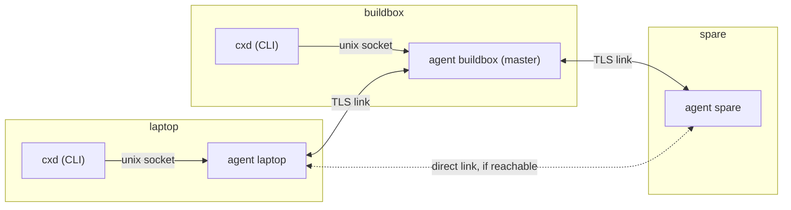

# Design: the broker transport

**Status:** proposed, revision 3 (after two reviews). Implementation follows in small pull requests; see the end of this document.

`cxd` reaches other machines over ssh. Each operation is one `ssh <alias> cxd _rpc`, and `cxd watch` holds a stream open. That works well, but every pair of machines needs an ssh alias and a key.

The broker adds a second transport: a small mesh of `cxd` agents, one per machine, that carries the same operations. Machines that have paired reach each other through it, and ssh stays as the automatic fallback.

The design follows the owner's requirement, in his words: *"Dual support, dynamic master - slave handling"*:

- **Dual support.** The broker and ssh both carry every operation, and `cxd` picks one per call.
- **Dynamic master.** One agent holds a lease as the master. When the lease lapses, the highest-priority reachable agent takes over. A recovered agent does not preempt it.

## Goals

1. **Self-hosted.** Python standard library and TLS only: no third-party packages, no third-party services, no relays outside the paired machines. The system `openssl` binary is a system tool like `ssh`; it generates the certificates, because the standard library cannot generate keys.
2. **One agent per machine** (`cxd agent`), running as the user. It owns this machine's identity, keeps links to the other members, and executes the operations addressed to this machine, exactly as `cxd _rpc` does today.
3. **Pairing a machine takes two commands at a terminal:**
   - `cxd join <addr>` on the new machine shows a short code.
   - `cxd accept <code>` on *any* member admits it.
4. **A dynamic master with a lease.** When the lease lapses, the highest-priority reachable member promotes itself. There is no preemption: a restarted or reconnecting member never takes over from a master that is serving.
5. **At-least-once delivery** of every request, with ids and deduplication. A retry, including one over ssh, never executes an operation twice.
6. **Automatic ssh fallback** when no master is reachable, or when the broker cannot reach the target.
7. **Same commands.** The broker plugs in behind the existing `Transport` interface (`call`, `stream`), so `cxd start/send/watch/stop/resume/list/doctor` do not change.

## Non-goals

- **NAT traversal, and relays on the internet.** Members must reach each other directly, on a LAN or a VPN. One direction per pair is enough (see Links).
- **Multi-user meshes.** All members belong to one person. The trust boundary is your own machines (see Threat model).
- **Consensus-grade replication.** With two machines there is no majority. The design keeps a single master in the normal cases, including a restart and a member that reconnects after sleep. A partition can briefly produce two masters, and that heals deterministically and without preemption (see Lease and election).

## Terms

| Term | Meaning |
| --- | --- |
| member | a machine admitted to the mesh; it runs one agent |
| node id | a member's stable id: the SHA-256 fingerprint of its certificate's DER, in hex |
| name | the member's `cxd` host name (`self` in config.json), used in commands; unique in the mesh |
| link | one TLS connection between two members, usable in both directions |
| master | the member holding the current lease |
| term | a counter that grows with every new lease holder and orders masters |
| request | one operation (`op`, `args`) addressed to a member, with a unique id |

## Architecture



- **The local socket.** The CLI talks only to its local agent, over a unix socket at `~/.cxd/agent/s`. The name is short because macOS limits socket paths to 104 bytes. The socket has mode 600 inside the mode 700 home, so file permissions do the authentication, as for the rest of `~/.cxd`.
- **Links.** Agents talk to each other over mutually authenticated TLS links (below).
- **Routing.** A request takes the first next hop that exists:
  1. a direct link to the target;
  2. the master;
  3. any member that reports a link to the target. Members list their live links in `hello` and in state messages.

  When no hop exists, the origin answers `unreachable` at once, so `auto` falls back to ssh without waiting.
- **Execution.** The target agent runs the operation with the same `state.OPS` functions that `cxd _rpc` uses. For `watch` it streams `state.stream()`.
- **One agent per machine.** An agent holds `~/.cxd/agent/lock` (flock) while it runs, so a second agent on the same machine exits at once.
- **Version check.** An agent runs the code it was started with. `cxd doctor` warns when the agent's version differs from the installed `cxd`, for example after a plugin update. Restart the agent to pick up the new code.

### Links

A link is a long-lived TLS connection. Either side may have dialed it; once up, it carries traffic both ways.

**Who dials.** Every agent keeps trying to keep a link to the master, always, and best effort to every other member whose address it knows. It retries with backoff from 2 to 60 seconds.

**One direction is enough.** A member that accepts no inbound connections still works, because the other side dials it or both dial the master. Examples are a WSL2 instance behind Windows NAT, or a laptop behind a firewall.

**Addresses.**
- `listen` in config.json (for example `0.0.0.0:47100`) is what the agent binds.
- `advertise` (for example `<lan address>:47100`, or the Windows host address and forwarded port for WSL2) is what it tells other members. A wildcard is never advertised.
- Each member also remembers the address a peer last connected from.

**Checks.** A dialer checks that the peer's node id is the member it meant to reach. A `hello` whose node is the agent itself, which happens when it dialed one of its own addresses, closes the link.

## Identity and TLS

**Keys.** On first use each agent creates an EC P-256 key and a self-signed certificate, valid for 10 years, in `~/.cxd/agent/`:
- `key.pem` is created with umask 077, so it has mode 600;
- the certificate is `cert.pem`.

The certificate's subject is unique: `CN=cxd-<16 random hex>`. Openssl gets an explicit `-config` file with the extensions below, so the result does not depend on the system's `openssl.cnf`:

```text
openssl ecparam -name prime256v1 -genkey -noout -out key.pem
openssl req -new -x509 -key key.pem -out cert.pem -days 3650 -config cxd-req.cnf -extensions cxd
# cxd-req.cnf, written per agent: [req] prompt=no, distinguished_name=dn; [dn] CN=cxd-<id>;
#   [cxd] basicConstraints=critical,CA:TRUE  keyUsage=critical,digitalSignature,keyCertSign
#         subjectKeyIdentifier=hash  authorityKeyIdentifier=keyid
```

The CN goes in the config, not `-subj`: LibreSSL ignores `-subj` when the config sets `prompt = no`.

Unique subjects and key identifiers let OpenSSL pick the right anchor out of a bundle of several self-signed certificates. With identical subjects and no key identifier it tries only the first one, and every other member fails verification. The node id is the SHA-256 of the certificate's DER encoding.

This was checked before implementing, on OpenSSL 3.6 with Python 3.14 and on macOS's LibreSSL 2.8.3 with Python 3.9.6. Two members pinned through one bundle both verify; a client without a certificate completes a `CERT_OPTIONAL` handshake and is seen as having none; an unpinned certificate is refused.

**Pinning: the node id, checked after the handshake.**
- **Trust bundle.** Each member keeps the certificates of all non-revoked members in the replicated state (below). It writes them to a CA bundle, `~/.cxd/agent/trust.pem`.
- **Verification.** TLS verifies the peer against that bundle, so only member certificates complete a handshake. The certificates are CAs (`CA:TRUE`), so in principle one could sign others. Pinning therefore rests on the mandatory node-id check after the handshake: the SHA-256 of the presented certificate must be a current member's node id. It gets its own test and mutation.
- **Host names** are not checked: the pinned certificate *is* the identity.
- **Rebuilding.** An `SSLContext`'s trust store only grows, so the agent builds new contexts after every membership change and closes links whose peer is no longer trusted.

**One listener, two kinds of client.** The server context uses `CERT_OPTIONAL` with the trust bundle loaded:
- a member presents its pinned certificate, which must verify;
- a joining machine presents **no** certificate, and its connection may carry only `join` messages.

A client certificate that fails verification aborts the handshake. Under TLS 1.3 the client notices only at its first read, so the client treats a closed link right after the handshake as an authentication failure.

**Protocol floor: TLS 1.2.** The `python3` that ships with macOS is linked against LibreSSL 2.8, which has no TLS 1.3.
- **Ciphers** are restricted to ECDHE key exchange with AES-GCM or ChaCha20-Poly1305.
- **TLS 1.3** is used where both sides support it.
- **Compression and renegotiation** are disabled (`OP_NO_COMPRESSION`, and `OP_NO_RENEGOTIATION` where Python offers it).

**After the handshake** each side checks that the peer's node id is a member and not revoked. Then both exchange a `hello` (see Protocol).

**Frames.** Before authentication a frame may be at most 64 KiB, and a joining connection may send at most 4 frames. After authentication the limit is 8 MiB.

## Pairing: `cxd join` and `cxd accept`

Pairing has to work before the new machine is trusted, so it uses a separate, small path. That path ends only with a human who confirms on both machines.

**Both commands need a real terminal.** `cxd join`, `cxd accept`, `cxd members remove` and `cxd members priority` read their confirmation from `/dev/tty` and refuse without one. The agent's socket accepts these changes only from a CLI that has passed that check.

This stops the common case: a session that has been prompt-injected ("run `cxd accept ABCDE-FGHJK`") and runs commands through Claude Code's Bash tool, which has no controlling terminal. The implementation verifies that on both platforms. A session that deliberately allocates a pty (`script`, Python's `pty`) gets around it; see Threat model.

1. **Joiner connects.** On the new machine, `cxd join <addr>`:
   - refuses if this machine is already a member;
   - creates the agent identity if needed;
   - connects to `<addr>`, any member's advertised address, with TLS and **without** a client certificate. It does not verify the member's certificate yet, but records its fingerprint `member_fp_seen`.
2. **Commit.** The joiner sends `{"t": "join", "name", "cert": <its PEM>, "commit": SHA-256(nonce_j)}`, where `nonce_j` is 32 random bytes.
3. **Member's nonce.** The member checks that the name is free and records a pending join with:
   - the joiner's node id `joiner_fp` (the SHA-256 of its certificate's DER), its name and address, and the commit;
   - its own node id `member_fp`;
   - an expiry of 10 minutes.

   It answers `{"nonce_m"}` with 32 random bytes. The joiner never trusts a fingerprint sent in a message, only what TLS showed it.
4. **Reveal.** The joiner sends `{"nonce_j"}`. The member checks it against the commit and drops the pending join on a mismatch.
5. **The code.** Both sides compute:

   ```text
   code = base32( SHA-256( "cxd-join-v2" | member_fp | joiner_fp | nonce_m | nonce_j ) )[:10]
   ```

   - The joiner uses `member_fp_seen` and its own fingerprint.
   - The member uses its own node id and the node id of the certificate in the message.

   The joiner shows the code as `ABCDE-FGHJK`, with the member's name and address, and waits.
6. **Accept.** On any member, `cxd accept ABCDE-FGHJK` looks for a pending join with that code. It shows the joiner's name, the address it connected from, and its fingerprint, then asks for confirmation at the terminal. Accepting adds the joiner as a member, with priority below every existing member unless `--priority` says otherwise.
7. **Join completes.** The joiner's waiting connection receives the replicated state. The joiner writes its trust bundle and from then on connects like any member.

**Why this is safe.**
- **A man in the middle** must show its own certificate to each side, so the two sides compute codes from different fingerprints.
- **Grinding the code is impossible.** The joiner commits to its nonce before it sees the member's, and the member's nonce is fixed before the joiner reveals. A man in the middle cannot search for nonces that make the two codes match, so its chance per attempt is 2^-50.
- **Each attempt costs a pending join**, which a human must also accept.

**Limits.**
- **Per member.** A member keeps at most 5 pending joins. When full it refuses new ones rather than evicting old ones, so a flood cannot push out a real join.
- **Tied to the connection.** A pending join lives only while the joiner's connection stays open, so a host cannot park joins and walk away. `cxd members pending` lists them and `cxd members pending --clear` drops them.
- **Per address.** It accepts at most one join attempt per source address every 10 seconds.
- **Replication.** Pending joins are replicated through the master, so that `accept` works on any member. Without a reachable master, `accept` works only on the member that received the join.

**The first member.** A machine with `listen` set accepts joins before it belongs to any mesh. Its first `cxd accept` creates the mesh, with itself as the master at term 1 and the joiner as the second member. `cxd join` on a machine that is the only member of its mesh leaves that mesh and joins the new one.

**Leaving.** `cxd members remove <name>`, on any member, revokes a member (see Revocation).

## Replicated state

Each agent keeps one state file, `~/.cxd/agent/state.json`:

```text
{ "members": { node_id: {name, cert, advertise, priority, rev} },
  "revoked": { node_id: {name, at} },
  "pending_joins": [ ... ],
  "lease": {"term": t, "master": node_id} }
```

- **Membership entries** carry a version `(rev, term, writer)`. Only a master changes membership; `accept` and `priority` need a reachable master, and say so when there is none. Merging keeps, per member, the entry with the higher version, compared in that order, so two masters of a split cannot produce a tie. The name of a member is unique: an `accept` whose name is taken is refused.
- **Revocation is sticky and needs no master.**
  - `cxd members remove` adds the node to `revoked` locally at once and drops its links. The revoked node is removed from the trust bundle.
  - Revocations travel in every `hello` and every state message, and merge by union, whatever the term.
  - A revoked node id is never trusted again. Re-pairing the machine creates a new key, and so a new node id.
  - Every lease or state message that comes from, or names as master, a revoked node is ignored.
  - A member that sees its own node id revoked stops its agent and says why in its log and in `cxd doctor`.

## Lease and election

- **Holding the lease.** The master holds a lease of `LEASE = 15 s` and renews it every `LEASE / 3`. A renewal `{"t": "lease", "term", "master", "provisional", "seq", "remaining"}` carries the seconds left, not an absolute time. A receiver sets its own deadline to its monotonic clock plus `remaining`, so the wall clocks of different machines never matter.
- **Forwarding.** Members forward a renewal to their other links only if its `(term, master, seq)` is newer than what they have seen for that master. That makes forwarding stop, and two masters at the same term never hide each other.
- **Lease views travel.** Every `hello` and `pong` carries the sender's current lease view (term, master, provisional, and the seconds left by its own clock), so a member learns about a live lease the moment a link comes up, without waiting for the next renewal.
- **Grace.** A member never promotes during its first `2 x LEASE` after it starts, and again for `2 x LEASE` after it leaves the alone state (below), for example after waking from sleep. In that time it dials, exchanges hellos, and learns the master.
- **Lapse.** A member that has seen no renewal for `LEASE + 3 s` treats the lease as lapsed.
- **Pre-vote.** Before it promotes, a member asks every member it can reach (a live link and a `pong` within 2 s) for its lease view. If any of them reports a live lease, the member follows that master instead.
- **Promotion.** If no reachable member holds a live lease:
  - **With others:** if the member can reach at least one other member, the reachable member with the highest priority promotes itself to `term + 1`, ties going to the lower node id. Every other member waits `LEASE` for that member's renewal before it checks again.
  - **Alone: provisional:** if it can reach **no** other member, it promotes itself as a *provisional* master, without raising the term. A provisional master serves its own CLI. It becomes a regular master, at `term + 1`, as soon as another member links to it and accepts its lease. That is the two-machine failover: when the master dies, the survivor becomes master, and stays master when the old one comes back.
- **No preemption.** A member that hears a live lease, through renewals or lease views, never takes over, whatever its priority. A restarted or reconnecting high-priority member therefore joins as a follower.
- **When two masters meet.** This happens after a partition. The comparison order is:
  1. the higher term wins;
  2. on equal terms, a regular master beats a provisional one;
  3. then the higher priority;
  4. then the lower node id.

  The loser steps down at once. Because a provisional master never raises the term, it always yields to a master whose lease never lapsed, so a partition never ends in preemption. Membership entries merge by version, and revocations by union.
- **Routing never needs exactly one master.** Requests carry their target and travel over any path that reaches it, so a split brain only changes which member relays.

## Delivery: at-least-once, deduplicated, never twice

Every request that changes something (`start`, `send`, `stop`, `resume`, `notify`, `prune`) has an id: 128 random bits in hex. The CLI generates it once per logical operation, and it stays the same for every retry, including a retry over ssh. Read-only requests (`ping`, `list`, `doctor_info`) and streams skip the claim store; a stream is identified by its own stream id so that `cancel` can stop it.

- **Claim on arrival.** The target agent claims a request id before it executes anything. It writes `{"state": "awaiting", ...}` to a temporary file and links it to `~/.cxd/dedupe/<id>.json` with `os.link`, which fails if the name exists. That makes the claim atomic: no reader ever sees an empty file. The target then answers `accepted` and **waits for `go`**.
- **The origin says go.** The origin sends `go` only while its CLI is still waiting. On `go` the target sets the claim to `running` (with its pid and process identity) and runs the operation. It then writes `{"state": "done", "reply"}`, or, in a `finally`, `{"state": "error", ...}`, before it answers.
- **No `go`, no run.** A claim that gets no `go` within 30 s lapses to `cancelled`. So when the CLI gives up before `go` (exit 4), nothing has run and nothing will. That keeps the meaning of exit 4: the host could not be reached, so nothing was decided.
- **A duplicate never executes again.** It first answers `accepted`, then:
  - **awaiting:** a duplicate that arrives with its own waiting client (the ssh fallback, or a broker retry with `go`) takes the claim over and runs it, once;
  - **running, executor alive:** waits for the result;
  - **running, executor dead:** returns `outcome_unknown`, which is exit 6;
  - **done:** returns the recorded reply;
  - **error:** returns the recorded error;
  - **cancelled:** returns `cancelled`.
- **The ssh path uses the same store.** `cxd _rpc` receives the id from `SshTransport`. The protocol version (`PROTO`) goes up to 2, so an older `_rpc` refuses the request instead of silently dropping the id.
- **Expiry.** Records expire after 24 hours and are pruned with the sessions.
- **Origin retries, before and after `accepted`.**
  - **Before `accepted`,** it resends over a new path whenever a link drops or the master changes, until the broker timeout.
  - **After `go`,** on any link drop or master change, it re-issues the same id, over the broker or over ssh. The target answers from the claim: it waits, or returns the recorded reply. A reply lost with a dying relay is therefore fetched again rather than lost.
  - **A timeout after `go`** is exit 6 (`outcome_unknown`: the request reached the host, check its state), never exit 4.
- **Loops and replies.** Each request carries `path` (the node ids it went through) and `ttl` (4). A relay never sends a request back to a node already on its path. It never drops a request just because it has seen the id before. Replies go to the origin by node id, over whatever link reaches it at the time.
- **Timeouts bound delivery, not the operation.** The broker timeout (`broker_timeout`, default 30 s, longer than a failover) limits the wait for `accepted`. After `go`, the call waits with the timeout the CLI already passes for that operation (for example `(grace or 120) + 120` for stop, and the start timeout plus `--init-timeout`).
- **Size.** The origin refuses a request whose frame would exceed 7 MiB, with a usage error, instead of retrying it forever.
- **Streams.** `watch` resumes from a cursor that the host owns. Every stream message carries the cursor as it stands **after that message**, not after its batch, so a break between two events of one batch loses neither. This also fixes the ssh path, which has the same flaw today. Over the broker a stream carries `hello`, `event`, `keepalive`, `end` and `error`. `cancel` with the stream id stops it on the target, so reconnects do not leave polling streams behind. After any break, on either transport, the client resumes from its last cursor. Only the owning host can report an exit.
- **Ordering.** The CLI waits for each reply, so requests from one client to one target run in the order the client issued them. Concurrent clients get no ordering guarantee, the same as over ssh.

## Transport selection and ssh fallback

`hosts.<name>.transport` in config.json is one of:

| Value | Behaviour |
| --- | --- |
| `local` | this machine (as today) |
| `ssh` | as today |
| `broker` | broker only; when unreachable, the call fails with exit 4 |
| `auto` | broker first, ssh per call (below) |

**`auto` falls back to ssh for one call** when any of these holds before `accepted`:
- the local agent is not running;
- the broker reaches neither a master nor a direct link to the target;
- the target is not linked;
- `broker_timeout` passes.

The fallback reuses the request id and never sends `cancel` first. The ssh copy takes over a claim that is still awaiting `go`. A broker copy that arrives later waits for, or returns, the ssh copy's result. Either way the operation runs once. After `go`, a broken broker path is re-issued over ssh in the same way. `watch` switches transports between reconnects.

**Which value a host gets.**
- **On joining,** `cxd join` and `cxd accept` set each mesh member's host entry to `auto` when it has ssh settings, and to `broker` when it has none.
- **`cxd init --peer`** still writes `ssh`.
- **An unknown name** that is a mesh member resolves to the broker.

`cxd list`, `cxd doctor` and `cxd watch` show which transport carried each call, for example `via broker (master buildbox)` or `via ssh (broker: no master reachable)`.

## Protocol

Messages are framed as one JSON object per line, UTF-8, ending with `\n`. The size limits are in Identity and TLS. Every message has a type `t`.

The first message on a member link is a `hello` from each side, carrying:
- `v`, the broker protocol version (1);
- `node`, `name` and `advertise`;
- `term`, the sender's lease view;
- its member revisions;
- `revoked`, the full set.

A mismatched protocol version closes the link with a reason.

| `t` | Direction | Fields |
| --- | --- | --- |
| `hello` | both | see above |
| `lease` | master to all, forwarded while newer | `term`, `master`, `seq`, `remaining` |
| `state` | master to all, and on request | replicated state (see Replicated state) |
| `ping` / `pong` | both | `id` |
| `req` | origin to target, via relays | `id`, `from`, `to`, `op`, `args`, `path`, `ttl` |
| `accepted` | target to origin | `id` |
| `go` | origin to target | `id`: the CLI is still waiting, so run it |
| `unreachable` | origin agent to CLI | `id`: no next hop to the target |
| `rep` | target to origin | `id`, `ok`, `result` or `error` and `code` |
| `stream` / `end` / `error` | target to origin | `id`, `msg` (one `state.stream()` message) or `error` |
| `cancel` | origin to target | `id` or stream id: stop a stream, or drop a claim still awaiting `go` |
| `join`, `nonce`, `reveal`, `joined` | join connection only | see Pairing |
| `accept`, `remove`, `priority` | any member to master | the change; `remove` also applies locally at once |

The local unix socket uses the same framing with two requests:
- `call` (`op`, `args`, `to`, `id`) is answered by `accepted` (the agent sends `go` for the waiting CLI) and then `rep`, or by `unreachable`;
- `open` (a stream) is answered by `stream`, then `end` or `error`.

## Command line and configuration

```text
cxd agent [start|stop|status|run]   run (foreground) is for systemd/launchd; start daemonizes
cxd join <addr>                     on the new machine, at a terminal; shows the code and waits
cxd accept <code> [--priority N]    on any member, at a terminal
cxd members [--json]                members, priorities, links, master, term, revoked
cxd members pending [--clear]       pending joins on this member
cxd members remove <name>           at a terminal; takes effect locally at once
cxd members priority <name> <N>     at a terminal
```

New keys in `~/.cxd/config.json`:

| Key | Meaning |
| --- | --- |
| `listen` | the addresses to bind; default none, so outbound only |
| `advertise` | the addresses to give other members |
| `priority` | this machine's own priority, used when it creates a mesh |
| `hosts.<name>.transport` | `local`, `ssh`, `broker` or `auto` |
| `hosts.<name>.broker_timeout` | seconds to wait for `accepted` before falling back (default 30) |

`cxd doctor` gains checks for the agent: running, identity present, member of a mesh, links up, master known, lease fresh, and the agent's version matching the installed `cxd`.

## Operations

- **Starting the agent.** Run `cxd agent start` once per machine, or install `cxd agent run` as a user service. `cxd agent install` writes the unit and records the current `PATH` in it, because services do not get your shell's `PATH` and `claude` or `cswap` may live under Homebrew, nvm or `~/.local/bin`. The documentation ships both unit files:
  - The systemd `--user` unit sets `KillMode=process`. Otherwise stopping or restarting the agent would kill every run it started, because they share its cgroup.
  - The launchd agent sets `AbandonProcessGroup` to `true`, for the same reason.

  Runs started through the agent therefore survive an agent restart, as runs started through `_rpc` do today. On Linux, `loginctl enable-linger` keeps the user's systemd instance, and the agent, running without a login session. Runs that need an ssh agent (for example to push with git) see `SSH_AUTH_SOCK` only if the unit is given it.
- **Ports.** A machine needs an open TCP port only if it should accept inbound links. One reachable member is enough for the mesh to form.
- **WSL2.** A WSL2 machine in NAT mode accepts no inbound connections unless Windows forwards the port. It can still be a member, and the master, by dialing out. Set `advertise` to the Windows address and forwarded port if you do forward one.
- **Logs.** The agent logs to `~/.cxd/agent/agent.log`, rotated at 5 MiB. Logs never contain message text, only ids, ops and sizes.

## Threat model

**Assets.**
- The ability to start, steer and stop Claude Code sessions on your machines. Through a worker with permissions, that is the ability to run commands.
- Message and report contents.
- The agent private keys.

**Trust boundary.** Members are your own machines under your own user. Anyone who can act as your user on a member already has full control of that member, and through `cxd` (and ssh) of the others. The broker must not widen this to anyone else, and not to a Claude session that has been tricked.

| Threat | Mitigation |
| --- | --- |
| Someone on the network connects to an agent port | Mutual TLS with pinned member certificates. A connection without a certificate can only attempt a join. It gets tight frame limits, at most 4 frames, and a rate limit per address. |
| Someone joins themselves | A join stays pending until a human, at a terminal on a member, accepts the code that the joining machine shows. The code is unguessable: 50 bits, a 10-minute expiry, at most 5 pending joins, refused rather than evicted when full. |
| A man in the middle during pairing | The code binds both TLS certificates as each side saw them, and the nonces are committed before they are revealed. A man in the middle produces different codes on the two sides and cannot grind them into agreement. |
| A prompt-injected Claude session pairs or edits the mesh ("run `cxd accept …`", "run `cxd join attacker:47100`") | join, accept, remove and priority require a confirmation read from `/dev/tty`, and the agent accepts these changes only from such a CLI. Claude Code's Bash tool has no controlling terminal, so they refuse. A session that is induced to allocate a pty on purpose gets around this gate. The gate stops a session that only runs commands, not one that writes and runs its own terminal emulation; the remaining defence is that a human must also see and approve the pairing on the other machine. |
| A stolen member key | `cxd members remove` on any member revokes the key locally at once. The revocation spreads in every hello and state message, and nothing can undo it. Lease and state messages from or naming a revoked node are ignored. The key file is mode 600, so stealing it requires your user account on that machine. |
| A malicious or compromised member | Out of scope by definition, because a member is you. Revoke it as above. Relays see request contents; they are members too. |
| Replay of captured traffic | TLS prevents replay on the wire. A replayed request id is answered from the dedupe store and never executed again. |
| A late duplicate after a timeout or fallback | Claim on arrival, a `go` from the waiting origin before anything runs, and claims without `go` lapsing to cancelled. An operation never runs twice; exit 4 means nothing ran; exit 6 means the outcome is unknown. |
| Flooding and oversized messages | Frames are limited (64 KiB before authentication, 8 MiB after); joins are rate-limited per address; links that send malformed frames are closed. |
| Requests looping between relays | A path list and a hop limit (`ttl`). |
| A downgrade to weak TLS | TLS 1.2 is the minimum, with only ECDHE and AEAD cipher suites; compression and renegotiation are off. |
| The local socket used by another user | `~/.cxd` is mode 700 and the socket is mode 600. |
| Information in logs | Logs hold ids, ops, sizes and timings only, never message text or tokens. |
| A third-party or US-hosted relay | None exists: agents connect only to addresses of members you paired. Pairing and traffic stay on your machines and your network. |

**Residual risks.**
- **A stolen key before it is revoked** can act as a member, including revoking the real members permanently. Revocation cannot be undone, so recovery is re-pairing the machines with new keys. A member is you, so this is equivalent to a compromised account.
- **Split brain.** A partition that separates groups of members can briefly produce two masters. That only affects which member relays, and healing is deterministic.
- **Accepting a code without checking it.** A human who confirms a code they did not check on the joining machine admits whatever machine produced it. `accept` therefore shows the joiner's name, address and fingerprint before it asks for confirmation.

## Testing and evidence

**Unit tests.** All of them run agents on localhost under separate `CXD_HOME`s, ports and identities, with the stub claude:
- certificate generation and pinning with several members;
- framing limits;
- the dedupe store: an atomic claim, `go`, a lapse without `go`, a duplicate while awaiting or running, an executor that died, the takeover by an ssh copy, and the store shared with `_rpc`;
- the join code, including a simulated man in the middle and a grinding attempt;
- the `/dev/tty` requirement;
- the lease and election: a lapse, priority order, the pre-vote, no preemption after a restart or a reconnect, provisional promotion when alone and its upgrade, healing (term, then regular over provisional), sticky revocation;
- relaying, retries through the same master, and replies by node id;
- the `auto` transport and the ssh fallback;
- watch resuming across a transport switch, and per-message cursors;
- the node-id check after the handshake (with a mutation).

Every guard gets a mutation in `tests/mutate.py`.

**Real nodes.** These steps run on two real machines, one Linux (WSL2) and one macOS. Logs go to `docs/evidence/`.

1. **Pair** the machines. A human confirms at a terminal; when the pairing is driven by a script, that script drives a pty on the human's behalf, and the evidence says so.
2. **Operate.** Run start, send, watch, stop and resume through the broker.
3. **Failover.** Kill the master's agent. Show that the survivor promotes (provisionally) and keeps serving: watch resumes, and runs survive.
4. **No preemption.** Restart the old master. Show that it joins as a follower, and that the survivor becomes a regular master.
5. **ssh fallback.** Block the broker port in both directions. Show the ssh fallback, including during a long-running operation, with no operation executed twice.

A third agent, under its own `CXD_HOME` and port on one of the machines, then shows a regular (non-provisional) promotion and relaying through the new master.

## Implementation plan

1. This design document.
2. `lib/cxd/broker/identity.py`: key and certificate generation (explicit openssl config), fingerprints, the trust bundle, and both TLS contexts, checked against LibreSSL on macOS.
3. `lib/cxd/broker/wire.py` for framing, and `lib/cxd/dedupe.py` for the store (atomic claim, go, lapse, done, error, cancelled), wired into `cxd _rpc` (PROTO 2), with request ids in `SshTransport`, per-message stream cursors, and exit 6.
4. The agent core: the lock, the local socket, links, `hello`, executing requests, relaying by path, and replies by node id, with a static master.
5. Pairing: `cxd join` and `cxd accept`, commit and reveal, pending joins, and the `/dev/tty` requirement.
6. The lease and election: grace, pre-vote, provisional promotion, healing, sticky revocation, and `cxd members`.
7. `BrokerTransport` and the `auto` transport: next-hop routing, `unreachable`, re-issue after `go`, the ssh fallback, plus doctor checks.
8. `cxd agent install`, with the unit files (`KillMode=process`, `AbandonProcessGroup`, recorded `PATH`), the documentation, and the real-node evidence.
